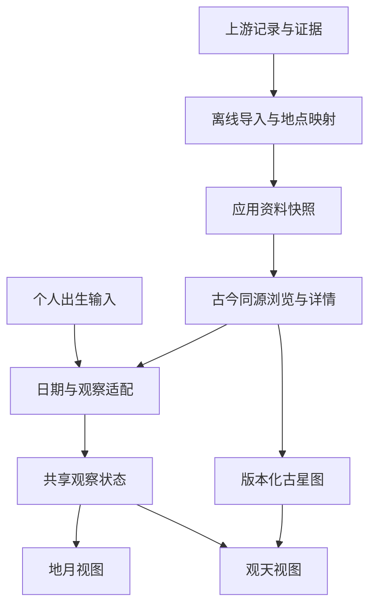

# 古星图、出生星空与古今同源联动

后续设计见 [地球与星空空间联动、月球真实与合影位置](2026-10-23-002-feat-earth-sky-spatial-link-plan.md)。用户已确认未来对缺少时刻的具体事件默认以当地 20:00 演示，并保留月球真实 / 合影位置切换、默认合影。该方案当前仅为设计，尚未修改应用；下文保留本轮已完成实现及当时验收记录。

## 目标与授权

将个人出生时刻、不同历史星官体系、人物及事件资料连接为可往返的体验。用户已要求“细化联动方案，做成文档后实现”，并指定接入现有 150 条目录；本方案沿用已确认的真实星位、文化图层分离、一个主要玻璃控制表面和现有地月构图。

2026-10-24 用户澄清：人物／事件的主要呈现沿用出生时刻的沉浸地月合照，地球标记所选地理位置，月球展示对应月相。选择记录后直接生成合照；当地天空保留为主动进入的次级视图。切换文化保持当前观看方式。无时刻事件默认当地 20:00 的演示政策及资料精度说明继续有效。此前将“选择历史记录”直接导航至观天页的实现不符合此意图，按该澄清纠正。

本轮在当前工作空间完成设计、实现与验证。隔壁继续采集的原始目录、取证文件及采集脚本只读；本轮建立独立的应用快照与可重复导入流程，不覆盖上游成果。不启动 agent，不创建分支或 worktree，不提交、推送或发布。

需求来源：本次用户要求；`reference/sky/2026-10-22-selection.md`；`docs/handoff/2026-10-21-history-and-sky.md`；150 条目录及其指向的三份记录集。

## 一、用户体验与关联规则

核心体验是“用古人的星空观念理解我的出生天空，并走进有出处的历史日期”。三种行为具有不同的时间语义：

| 行为 | 时间与地点 | 文化版本 | 返回行为 |
| --- | --- | --- | --- |
| 我的出生天空 | 用户输入的日期、钟点、明确的时间解释与地点 | 用户选择 | 保存为个人观察基准 |
| 用古星图读我的天空 | 不变 | 只替换星名、星官连线及解释 | 可切回原文化；相机方向保持 |
| 观看历史日期 | 使用资料规范日期、用户选定的演示钟点及明确的观测位置 | 保留当前版本；可主动选择相关时代版本 | 一键回到个人基准；没有个人基准时返回此前观察 |

地月与地面观天只是同一观察的两个视图。切换视图不得再次解释时区，不得悄悄改变地点，也不将地月相机当作地面地平相机。两者保留各自构图；返回后恢复原方向、缩放与选中对象。

### 1. 出生与历史资料怎样关联

- **同月同日**：按各自标明的前推格里高利民用日期的月日匹配，使用出生输入的当地日期，不用跨日后的 UTC 日期。名称明确为“同月同日（换算公历）”，不称作同一农历生日。
- **相近时节**：按公历年内相距不超过 14 天的循环日期距离推荐；显示相差天数。这是浏览线索，不宣称相同节气、月相或天空。
- **历史年代**：按记录发生年份分组；境外记录注明地区，不将其自动归属中国朝代。人物的出生年代不等于其一生的文化身份。
- **文化视角**：版本自带研究所针对的年代、依据与作者。相关年代只提供可选入口，不自动断言该人物使用了这份星图。
- **收藏与偏好**：用户主动收藏人物／事件、选择喜爱的星图版本，形成自己的探索入口。偏好保存在本机；不根据生日推断性格或“所属朝代”，不新增账户或社交发布流程。
- **历史上的今天**：以用户设备的当前当地月日匹配规范日期；空日明确显示没有收录，不将近邻日期伪装成当天。数据数量和覆盖范围由导入时统计。

原历纪念日、月亮落宿、同月相推荐、没有依据的人物—星官对应不能从现有字段推断。原历始终展示；这些尚不具备计算证据的关系不生成虚假结果。

### 2. 古星图的版本身份

本轮提供三个可计算的中国文化视角及已有现代 88 星座：

| 视角 | 本轮数据基础 | 显示方式 |
| --- | --- | --- |
| 陈卓体系 · 三世纪重建 | Stellarium v26.3 `chinese_chenzhuo`，杨伯顺整理 | 完整可用星官连线、名字、来源与重建说明 |
| 宋代星官 · 1052 体系重建 | 保留现有固定提交的数据 | 完整星官、二十八宿筛选及现有图绘 |
| 元代星官 · 十四世纪重建 | Stellarium v26.3 `chinese_yuan_dynasty` | 完整可用星官连线、名字与《天文汇钞》研究说明 |
| 现代 88 星座 | 保留已有 v26.3 数据 | 现有连线与图绘 |

星点始终来自同一现代星表并按观察时刻计算；历史连线通过明确恒星标识映射。导入必须检查全部端点，缺失恒星有证据地补入同版本星表，不靠更换星位修补。

陈卓体系是现代学术重建，不能标成敦煌星图的完整数字复刻。敦煌星图作为有出处的史料入口展示，后续只有建立其自身逐星映射后才可成为独立可计算版本。

玉皇庙图绘的元代彩塑来源、当代转绘身份、当前宋代星官配准分别标明。不会按朝代名称把现有 28 幅图强行套入不同星形；陈卓和元代版本首先准确展示其自身连线。现有图绘、56 张图片和左右关系不因联动被改动。

## 二、150 条资料的接入契约

### 输入与协作边界

指定入口：`output/history-dsh-fresh50-20261023-r2/catalog-150/records.json`。

上游三份完整记录：

- `output/history-dsh-parallel-20261022/export-stage/export/records.json`
- `output/history-dsh-complete15-20261022/final-50/records.json`
- `output/history-dsh-fresh50-20261023-r2/new-50/records.json`

本次读取时为 90 条人物出生、60 条事件。85 条为条件性格里高利解释，12 条为历法数值对应核验，7 条为计算一致，46 条标为不适用。150 条均未标记为 production ready，不能因导入而升级为已核实的出生／事件瞬间。

应用生成独立的 `src/history/data/records.json` 与导入清单。原记录 ID 加稳定资料集命名空间构成 ID，保留原 ID、批次、源文件与哈希。后续更换上游目录即可重新导入；重复 ID、缺失完整记录、日期/JDN 冲突、非法来源链接或坐标越界使生成失败，不写出半份数据。

### 标准记录

| 字段组 | 内容与职责 |
| --- | --- |
| 身份 | 稳定 ID、人物／事件、名称、原 ID 与批次 |
| 日期 | 原历文字、原历类别、规范公历日期、名义日 JDN、解释状态、说明 |
| 时刻 | 保留原记录的时刻精度与说明；缺少 UTC 时保持为空 |
| 地点 | 原地名、地点角色、原精度；观测代表点另存，含现代地名、经纬度、依据、精度 |
| 来源 | 来源 URL、已有标题、支持字段；完整取证仍留在上游，不将长篇引文打入网页 |
| 不确定性 | 上游剩余检查、历法条件、时刻缺失、地点待定等独立字段 |
| 应用状态 | 可检索、可解释日期、可选择观测位置、可生成演示；与史料生产就绪状态分开 |

所有 150 条可检索、浏览和查看出处。可生成演示不等于已确认史实钟点。

### 地点适配

采用项目现有经纬度表提供的现代地点代表点，并建立独立、可审计的历史地名映射表。只从记录明确给出的现代地点或可靠同名关系选择代表点，不用模糊字符串命中推断出生地。

地点被明确到宅院但只有城市坐标时，显示“在某市代表点演示”，不能冒充建筑精度。原资料只有省域、存在同名歧义、多处事件路线或不能核实对应时，保留未知，由用户明确选择观测位置；所选位置标为用户演示位置，不回写成历史发生地。境外地点同样可由有来源的城市代表点或用户坐标进入。

## 三、时间与状态架构

### 共享观察契约

`Observation` 表达一次已经解析的观察：

- 唯一绝对时刻（ISO UTC，允许秒级精度）与经纬度；两种画面只消费这两个值。
- 用户可读的当地民用日期、钟点、地点标签与位置精度。
- 时间解释：明确 UTC 偏移，或明确选择的地方平太阳时演示。
- 来源：个人输入／历史记录演示／示例；历史记录 ID 与当次接受的解释。
- 演示时刻、演示地点、条件性日期等标记，跨视图保留。

`JourneyState` 保存当前观察、个人出生基准、进入历史前的观察、文化版本及用户收藏。地月与观天各自保存相机／构图状态，不能把相机参数混入时间地点契约。个人数据仅保存在当前会话；收藏与文化偏好可本机持久保存，读取失败时退回内存并提示。

### 日期与时刻的转换规则

1. 不把名义日 JDN 当作午夜或出生 UTC。规范日期是某一个历日；还需要用户所选的钟点和解释。
2. 历史记录没有已核实 UTC 时，钟点初始为空，用户必须选择。日期有条件性说明时，进入前展示并要求确认当次解释。
3. 历史演示可选地方平太阳时，以经度每度四分钟进行连续换算，明确其为现代演示约定；也可选明确的 UTC 偏移。二者都不声称恢复了当时的民用钟表制度。
4. 个人出生输入显示并允许修改 UTC 偏移；不再由经度四舍五入猜时区。不了解历史夏令时的用户可以查看说明并修正偏移，应用不暗称已经还原所有历史时区制度。
5. 使用严格前推格里高利解析，校验闰日、月日、时分、年份范围与跨日。处理 0001–0099 年时避开 JavaScript 对短年份的特殊行为。保留地方平太阳时产生的秒数，不让观天输入框截断共享瞬间。
6. 原有 `toUTCFromLocal` 的经度估算仅作为旧调试入口兼容。新联动始终传入明确绝对时刻；地月、月相、晨昏线不得二次套偏移。

以下图示表达模块边界和数据流，作为设计说明，不是待逐字照抄的代码：

## 四、界面安排

- 主要导航为“地月 / 观天 / 古今同源”；初始地月构图和 Xiu 入口继续保留。
- 古今同源在一个主要玻璃面板里完成搜索、筛选、详情和进入演示。打开时收起／隐藏原视图控制面板，避免多层玻璃争抢空间。
- 列表提供全部、人物、事件、同月同日、相近时节、历史上的今天及收藏；年代为附加筛选，明确记录覆盖范围。
- 详情先展示日期、地点、原历与出处，再展开解释及剩余核验项。观测钟点、时间解释、位置选择是进入历史天空前的必填决策。
- 观看历史天空后，画面持续标注记录名称与“演示时刻”；提供“回到我的出生时刻”或“回到此前天空”。
- 星图版本切换在观天中提供，记录名称、年代与重建身份可查。更换文化不改变 UTC、经纬度或观察方向；可保存偏好。
- 手机列表与表单可滚动，主要按钮至少 44 像素，关闭后留出完整天空；支持键盘、焦点恢复和减少动态效果。

## 五、实现单元与验收

- [x] **U1：资料快照与可重复导入**

文件：新增 `scripts/prepare-history-catalog.mjs`、`reference/history/location-overrides.json`、`src/history/historyModel.ts`、`src/history/data/records.json`、`src/history/data/manifest.json`；测试 `scripts/test-history-data.mjs`。

依据：三份原记录异构，但指定 150 条目录已有统一日期字段。合并原记录说明，独立解析来源与位置；记录哈希与统计，不修改原目录。

验收：150 条、90/60 分类和来源保留；重复导入得到相同结果；原数据变化可检测；JDN/ISO 一致；所有条件性解释保留；未知地点不能静默变成精确坐标；错误输入不覆盖已有产物。

- [x] **U2：共享观察、时间适配与关系检索**

依赖 U1。文件：新增 `src/history/observation.ts`、`src/history/journeyStore.ts`、`src/history/historyRelations.ts`；修改 `src/astro/ephemeris.ts` 的绝对时间兼容路径；测试 `scripts/test-history-observation.mjs`。

验收：闰年、0001–0099、东西经跨日、平太阳时秒数、负偏移、无效输入；日期而无钟点不能生成观察；条件性日期未经确认不能进入；同月同日采用当地日期；年末时节距离循环正确；更换文化不改观察；进入／返回历史恢复完整基准；存储拒绝与损坏可恢复。

- [x] **U3：古星图版本与来源**

独立于 U1，依赖现有星表。文件：新增 `scripts/prepare-historical-sky-cultures.py`、`reference/sky/historical-cultures/`、`src/spikes/sky/data/historical-cultures.json`、必要的补充星数据；修改 `src/spikes/sky/skyCultures.ts`、`src/spikes/sky/main.tsx`；测试 `scripts/test-historical-sky-cultures.mjs`。

验收：固定版本与授权可追溯；所有星官端点有映射或明确列出的非恒星限制；新增星点来自原 HYG 版本；切换陈卓、宋、元、现代只改变文化；不会把宋版图绘错误套到其他版本；原 28 幅配准与图片哈希保留。

- [x] **U4：古今同源面板与个人入口**

依赖 U1/U2/U3。文件：新增 `src/history/JourneyPanel.tsx`、`src/history/ObservationForm.tsx`、`src/history/journey.css`；在同一玻璃面板承接搜索、详情、观察选择、收藏和文化入口。测试关系检索放在 `scripts/test-history-observation.mjs`；界面通过实际浏览器验证。

验收：搜索苏轼及事件、类别和年代筛选、空结果、无记录的今天、收藏持久保存；未选钟点和未确定位置时禁用进入并给出原因；来源可直接打开；条件性日期确认在更换记录时重置；无重复提交和旧记录残留。

- [x] **U5：地月与观天的统一入口**

依赖 U2/U3/U4。文件：修改 `src/App.tsx`、`src/SimpleTest.tsx`、`src/spikes/sky/main.tsx`、`sky-spike.html`，按需新增独立入口文件；复用现有渲染器，任一时刻只挂载一个场景画布。

地月接受已解析的观察；原 client 时间地点表单接入同一状态。观天支持共享经纬度，不局限原有四个示例地点；独立 spike 保留自己的直接入口。相机快照独立保存，卸载释放渲染资源，返回恢复构图。

验收：同一历史记录在地月／观天的 UTC、经纬度完全一致；地方平太阳时产生的秒数不会丢失；多次往返不增加画布或纹理缓存；返回出生基准恢复地点、日期和镜头；既有固定太阳、月相、近景构图保持通过。

- [x] **U6：完整验证与交付记录**

依赖全部单元。记录到 `docs/handoff/2026-10-23-history-sky-integration.md`，证据写入本轮独立 `output/history-sky-integration-20261023/`。

验证数据、日期／关系、文化映射、严格类型及构建；运行适用的既有太阳、月相、近景和星图回归。浏览器走完个人输入→古文化切换→历史记录详情→选择演示→地月/观天往返→返回个人天空；覆盖宽屏和手机尺寸、条件日期、未知地点、跨日及收藏。真实 iPhone Safari 未实测时单独说明，不以模拟替代。

## 六、扩库协作方式

隔壁继续交付目录与证据即可，无需为每个新批次增加页面逻辑。应用导入契约维持原 ID、字段精度、历法解释和原始来源，不把新增采集的“可接受记录”自动提升为精确观测。

新增或更正资料先生成导入报告，列出增删改、日期解释变化、地点变化及仍需人工判断项，再替换应用快照。日期或地点修订使旧观察引用过期时保留已选择的演示参数并提示复核，避免静默改动用户收藏的历史天空。

## 七、研究依据与实际限制

- [Stellarium 陈卓体系说明与 CC BY-SA 4.0](https://github.com/Stellarium/stellarium/blob/v26.3/skycultures/chinese_chenzhuo/description.md)：现代重建；部分早期星官仍可能修订。
- [Stellarium 元代体系说明](https://github.com/Stellarium/stellarium/blob/v26.3/skycultures/chinese_yuan_dynasty/description.md)：《天文汇钞》相关十四世纪体系；不等于玉皇庙人物图绘。
- [国际敦煌项目](https://idp.bl.uk/discover/learning/chinese-astronomy/articles/the-chinese-sky/the-dunhuang-star-atlas/)：敦煌星图的历史与图像资料，作为独立史料入口。
- [USNO Julian Date 说明](https://aa.usno.navy.mil/data/JulianDate)：名义历日与连续时间须区别；不同地区历法改革时间不同，本项目不能套统一 1582 年断点解释所有来源。
- [IANA 时区数据库说明](https://data.iana.org/time-zones/theory.html)：数据库不足以精确处理所有历史地点的民用时间，不能把现代时区自动回推到所有古代记录。

目前古代恒星自行、双星及天文算法精度仍沿用已有试验的限制；本轮验证的是共享时间地点与文化映射，不宣称精确复原古人在特定时刻实际看见的全部天象。未核实宿界、来源冲突、未知出生钟点继续保持明确状态。

## 八、交付结果

U1–U6 已实现并验证，具体测试结果、浏览器证据、扩库命令及未解决的史料／设备限制见 [实现与验收记录](../handoff/2026-10-23-history-sky-integration.md)。150 条资料保持原始不确定性；三个中国历史文化视角与现代星座共用恒星计算，地月和观天共用观察瞬间。
