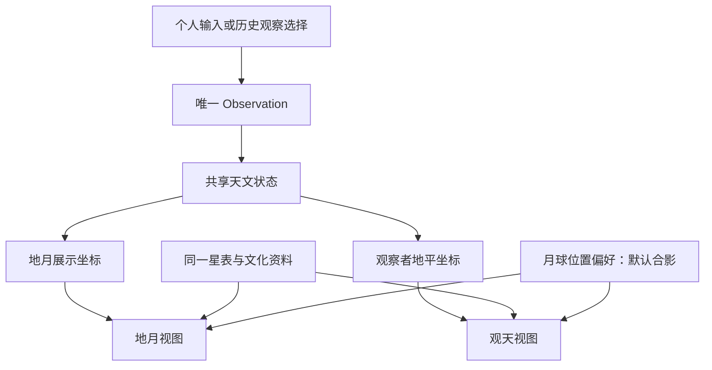
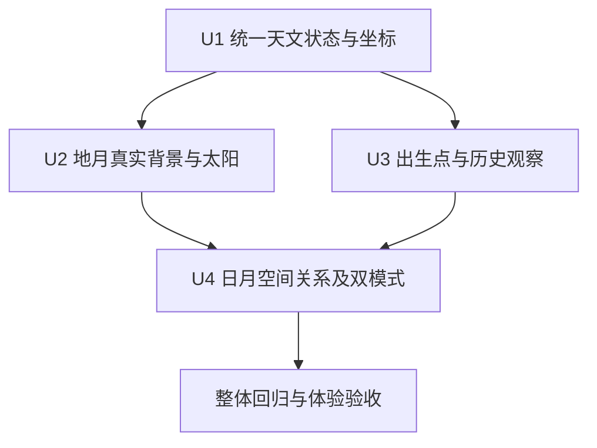

# 地球与星空空间联动、月球真实与合影位置

**2026-10-24 实施授权：** 用户已要求按本文完成全部四步与完整验收，继续默认合影位置、沉浸式体验和缺时刻事件当地 20:00。下文“本轮仅文档”的表述保留为 10 月 23 日设计阶段记录；实施不包含提交、推送或发布。

## 1. 目标、已确认决定与本轮边界

把已经共用时间、地点的地月与观天视图，连接为同一套可验证的空间关系。用户可以从地球上的出生地点进入当地天空，使用古星图理解真实星位，再进入历史日期并返回。默认以沉浸式合影体验呈现月球，同时允许主动切换到物理真实位置。

### 2026-10-24 呈现纠偏（用户澄清）

“古今同源”的主要结果是沿用出生合照：地球标出所选具体地理位置，月球显示同一瞬间的真实月相，自动进入原有沉浸近景。观天保留为主动进入的次级视图，不能替代地月合照。资料只提供地区代表点时仍明确标注精度，不把它当成历史建筑精确坐标；无时刻事件继续默认所选当地 20:00。

- `App.enterHistory` 提交共享 `Observation`，导航至地月，同时向 `SimpleTest` 发送一次性的 `ViewTransfer(reason: birth-point)`；消费后清除。普通地月／观天往返不重复对齐，不覆盖用户的月球模式偏好。更换文化图层留在当前视图。
- `SimpleTest.entryTransfer / onEntryTransferConsumed` 等待 UTC 和经纬度同步后复用现有 `applyBirthPointCloseup(true)`；历史合照和出生合照使用相同构图计算、单月球与单方向光。历史文案标明演示日期、钟点和地点。
- `DEFAULT_SIMPLE_COMPOSITION.showSkyCulture` 默认开启。地月背景继续使用真实星位、所选文化的连线与图绘；不做当地地平线或白昼裁切，不挪动星宿来迎合构图，也不通过关闭默认图层宣称已接入。
- 地月背景单独提高恒星、连线与图绘的显示对比，抵消明亮地月近景的视觉影响；观天原有显示强度保持。图绘仍按真实视场取舍：没有对应图绘资料的文化只显示其连线，人物图绘在镜头外时不移位补入。
- 验收：从观天或地月选择历史事件都直接得到沉浸地月合照；更换历史记录重新对齐新地点；往返恢复构图；个人基准可恢复；事件 20:00 的来源、UTC、地点和月相一致。桌面及窄屏实际截图须能辨认背景星宿，图层关闭／切换仍有效。性能区分应用主动限帧与浏览器吞吐；尽可能用 Chrome 或 Safari 复测，不将未接入的浏览器列为通过。

2026-10-23 用户已确认：

1. 采用**固定太阳方位、仰角随真实赤纬变化**的方案。固定的是地月展示坐标中的太阳水平方位，不是用户旋转相机后太阳在屏幕上的像素位置。
2. 按“统一天文坐标 → 地月背景接入真实星空 → 出生点与地平线接通 → 补齐日月关系”四步细化模块、接口和验收。
3. **具体事件缺少时刻时，默认当地 20:00**。这是可修改的演示时刻，不提升为史料事实。
4. 月球提供**真实位置 / 合影位置**两种选择；**首次默认合影位置，以沉浸式体验为主**。
5. 当前只交付设计文档，暂不修改应用代码、数据、配置或测试，不运行实现验证，不提交、推送或发布。

本设计延续既有单光常亮、相机独立于地球、星空独立于地球组、文化与星位分离、个人与历史观察可往返、单场景画布等约束。完整目标包含四步，分步验收不缩减最后交付。

需求追踪：

| 编号 | 要求 | 设计落点 | 验收落点 |
| --- | --- | --- | --- |
| R1 | 同一 UTC、地点驱动同一空间关系 | 天文状态、坐标适配、观察状态 | U1、A1–A4 |
| R2 | 太阳方位固定、季节仰角真实 | 地月展示变换、太阳方向 | U1/U2、A3/A4 |
| R3 | 地月背景使用真实星位与银河方向 | 共享星表、背景渲染 | U2、A2/A5 |
| R4 | 出生点、地平线及两视图往返一致 | 观察者基底、视图桥接 | U3、A6/A9 |
| R5 | 缺时刻的事件默认 20:00 | 历史观察选择规则、来源标记 | U3、A7 |
| R6 | 月球可选真实 / 合影，默认合影 | 月球展示偏好、双模式渲染 | U4、A8/A9 |
| R7 | 保留沉浸构图与古今文化体验 | 相机、图绘、显示层与物理层分离 | U2–U4、A5/A9 |
| R8 | 可追溯、可验证，实际限制清楚 | 精度契约、回归与交付证据 | 全部单元、A10/A11 |

## 2. 当前实现与需要补齐的关系

以下为本次只读调查结果，不代表新方案已经实现。

| 模块 | 当前行为 | 本设计需要补齐 |
| --- | --- | --- |
| `src/App.tsx` | 地月和观天消费同一 `Observation`，分别保存个人 / 历史构图 | 两视图消费同一版本的天文状态；月球模式作为共用偏好 |
| `src/history/observation.ts` | 将民用日期、钟点、地点及时间解释解析成 UTC | 增加钟点来源标记；由事件规则在解析前提供默认 20:00 |
| `src/history/JourneyPanel.tsx` | 所有历史条目的钟点初始为空，已有“选 20:00”按钮 | 仅缺时刻的事件自动预填；人物记录继续要求选择 |
| `src/spikes/sky/skyModel.ts` | 星表方向经 EQJ → HOR 转换为当地天空，含现有恒星自行处理 | 输出可在地月与当地天空复用的方向；加入日月观测状态 |
| `src/spikes/sky/MilkyWay.tsx` | 坐标化银河与星位共用 EQJ 基底 | 支持地月展示基底，不把地月背景误当当地地平天空 |
| `src/SimpleTest.tsx` | 银河按手工经纬角、缩放和独立自转显示；地球自转存在 UTC 小时乘 15 的路径 | 接入完整天文变换，取消精确联动中的独立背景转动和近似时角通道 |
| `src/astro/ephemeris.ts` | 将当地太阳 / 月球高度方位转换回旧世界方向，当前包含当地折射口径 | 全地球光照从地心太阳向量取得；当地视角另行计算 |
| `src/scenes/simple/api/components/Moon.tsx` | 屏幕锚定、相机锁相位及材质表现混合在同一组件 | 明确物理位置与合影位置入口，复用月面资源和同一份天文源 |
| `src/scenes/simple/utils/closeupShot.ts` | 已有近景相机与出生点构图求解及回归 | 保留构图目标，使用新状态给出的地球姿态 |

当前有三种不同的坐标表达需要显式连接：旧天文接口的 `World = ECEF(x,z,y)`、近景构图使用的地理法线，以及观天的东 / 天顶 / 南坐标。不能仅因为它们都叫 `Vector3` 就直接互传。

## 3. 总体结构与数据责任

> 下图表达模块关系与数据方向，供设计核对；它不是可直接复制的实现代码。下文接口表规定输入输出语义，具体函数拆分可在实现时调整。

### 3.1 三类状态

- **观察状态**：唯一绝对时刻、经纬度、时间解释、史料来源和演示假设。由历史模块持有，两视图只消费。
- **天文状态**：地心日月向量、距离、星位、坐标变换及当地观测结果。为纯派生数据，不写回出生资料或历史目录，不随相机和合影位置变化。
- **展示状态**：相机、视场、画面材质、古星图版本、月球位置模式与合影锚点。允许为体验调整，但不反向改变天文状态。

按 UTC、观测坐标、星表版本和计算口径生成状态键；同一次画面更新只使用同一个键的结果。快速修改日期或地点时，过期结果不得覆盖新观察。不在两个视图里分别解释时区或分别保存一份可编辑的天文时间。

计算核心只接受已解析时刻、坐标与数值策略，不依赖历史记录、React、DOM 或画布。历史模块负责输入语义，场景适配器负责显示；图绘与月面资源异步加载不得改变已经确定的天文状态。

### 3.2 模块与接口契约

表中的新增名称是拟定接口名；现有路径保留，新增文件在实施单元中明确列出。本轮不创建这些源文件。

| 接口 / 数据 | 拥有模块 | 输入 | 输出与不变量 |
| --- | --- | --- | --- |
| `Observation` | `src/history/observation.ts` | 民用日期、钟点、地点、时间解释、资料引用 | 保留现有 `utc/civilDate/clock/timeBasis/observer/source/assumptions`；增加结构化 `timeSelection`；新历史观察在 `source.recordKind` 保存 `birth/event` 类别快照 |
| `resolveHistoryChoices` | 新增 `src/history/historyObservationPolicy.ts` | 记录类别、时间精度、当次草稿 | 事件缺时刻时预填 20:00；不猜地点、不代为接受日期解释；输出选择来源 |
| `CelestialState` | 新增 `src/astro/celestialState.ts` | 已解析 UTC、星表及算法口径 | 地心太阳 / 月球 EQJ 位置与距离、日期赤道变换、地球定向、月相基准、版本键；全局部分不依赖出生地点 |
| `ObserverState` | 同上 | `CelestialState`、地理经纬度；本阶段海拔仍按 0 米 | 观察者位置、东 / 北 / 天顶基底、日月当地方向、角半径、几何高度方位、月相亮缘方向及可见性；月球包含地面视差 |
| `EarthSceneFrame` | 新增 `src/astro/referenceFrames.ts` | `CelestialState`、固定太阳方位、贴图标定常量 | EQJ → 展示、ECEF → 展示、太阳所在方向与光传播方向、地球姿态；坐标名称与方向语义明确 |
| `SkyRenderFrame` | `referenceFrames.ts` 与 `skyModel.ts` 适配 | 星表方向、目标坐标变换 | 恒星位置数组、HIP 索引、EQJ 基底、状态键；数组数目与星等、颜色缓冲完全一致 |
| `ObserverSkyFrame` | `src/spikes/sky/skyModel.ts` | `SkyRenderFrame`、`ObserverState` | 现有天空绘制所需字段及日月对象；地平遮挡只用于当地视图 |
| `ViewTransfer` | 新增 `src/history/viewBridge.ts` | 当前观察键、入口原因、可选目标 ID、已有视图快照 | 明确是普通切换、从出生点观天或主动定位目标；不携带重新解析后的另一份时间 |
| `MoonPresentation` | 展示控制层 | `portrait` 或 `physical`、天文状态、当前视图、该视图的合影布局 | 选择显示方式；不改月球轨道、距离、月相数据或出生地点 |

`timeSelection` 的必要字段：来源枚举、可为空的规则版本、可读说明。来源包括 `user-input`、`event-default-20`、`legacy-demo`、`system-example`；只有默认事件使用规则版本 `event-evening-v1`。`event-default-20` 要求历史来源、事件类别且钟点为 20:00；初始“此时的上海”属于 `system-example`。时间解释继续由 `timeBasis` 持有，不能仅写“当地时间”却缺少换算方式。

新增月球偏好字段为 `moonPlacement`，合法值 `portrait` / `physical`。`portrait` 是无保存值、首次打开和无效偏好恢复时的默认值。合影锚点、尺寸属于各自视图快照，不成为天文坐标。

## 4. 坐标、太阳与时间计算口径

### 4.1 明确每一种坐标

| 名称 | 约定 | 用途 |
| --- | --- | --- |
| EQJ | 右手系，J2000 平赤道；天体位置统一转换为 km，恒星为单位方向 | 星表、日月共同的天文输入 |
| EQD | 日期真赤道，包含库提供的岁差与章动处理 | 当天太阳赤纬及地球定向 |
| ECEF | 地心地固右手系；X 指向赤道零经线，Y 指向赤道 90°E，Z 指北极 | 地理坐标与地球姿态 |
| `LegacyWorld` | 保留旧接口的 `(x,z,y)` 分量约定 | 仅用于既有 API 兼容，不作为新物理核心 |
| `EarthScene` | 右手 Y-up 展示坐标；北极轴为 +Y | 地球、真实月球、恒星与太阳显示 |
| `ObserverSky` | +X 东、+Y 天顶、−Z 北 | 出生地点的当地观天 |

旧 `(x,z,y)` 映射交换两个轴，不能当作纯旋转四元数；其兼容适配用显式分量变换。新 `EarthScene` 的地理标定以已存在的 `closeupShot.ts` 法线 `(cosφ cosλ, sinφ, −cosφ sinλ)` 为参考，保留贴图接缝的常量校正。不得将这两套向量继续用同一个含混的 `world` 名字互传，也不全局替换旧接口的符号。

贴图零经线标定要用零经线、90°E、90°W、南北极和现有出生点共同验证。若纹理需要常量接缝偏移，该偏移只在地理到模型的适配处应用一次；星表、当地北方和太阳日期计算不增加手调偏移。

### 4.2 固定太阳方位，仰角取真实赤纬

采用以下方向契约：

- `sunDirectionScene`：地心指向太阳的单位方向。
- `lightTravelDirectionScene`：太阳光传播到地球的方向，等于前者的负值。
- 固定方位 ψ：在 `EarthScene` 水平面中按 `atan2(x,z)` 定义；它不是当地“北为 0°”的地平天文方位角。
- 仰角 δ：同一时刻、同一计算口径的**地心太阳日期赤纬**。它不依赖用户所在纬度，不采用出生地点的太阳高度角。

方向关系为：太阳所在方向的 Y 分量等于 `sin δ`，水平长度为 `cos δ`，水平角保持 ψ。这是一项数学约束，不依赖近似的年内正弦季节函数。

展示变换依次把 EQJ 转到日期赤道、映射成右手 Y-up，再绕 +Y 旋转，使太阳水平投影对齐 ψ。**地球姿态、恒星、银河和真实月球都使用同一展示变换。** 地轴因此保持竖直，太阳仰角随赤纬变化，天体之间的夹角保持不变。

地球姿态来自恒星时与日期坐标变换，不再以“UTC 小时 × 15°”代替完整定向。地球 mesh、云层地理纹理、出生点均消费该姿态；相机和星空保持独立节点。背景在时间改变时可随展示参考系更新，但不能因挂在地球节点上被多转一次。

原 `fixedSunDir` 的水平投影按“入射光”语义转换成太阳方位，用于沿用已保存的水平方向；Y 值由真实 δ 派生。水平分量退化时使用现有默认方向的水平投影。手调黄赤交角、季节日期偏移、当地高度强制一致等调试字段不进入这条精确链路。

### 4.3 地心几何与当地观测分开

- 全地球光照使用地心太阳方向。不能把某一地点经过大气折射的太阳高度反推成全地球的太阳方向。
- 月球真实位置保留地心方向和距离；当地观天另减观察者位置后计算方向、距离与角半径。不能只旋转地心月球单位向量而忽略视差。
- 基础坐标、全球光照和本轮默认天空统一采用**无大气折射**的几何口径。当地折射不能偷偷影响地球姿态或背景；未来加入折射时必须另有显示字段与统一测试。
- 日月向量遵循当前 Astronomy Engine 的光行时与像差选项，并记录口径；本方案选择不附加年周像差，保留库的光行时语义，与现有恒星几何基准对齐。不要把此显示契约描述成严格的同时刻动力学轨道解。
- 纬度 / 经度采用地理输入，海拔延续现有 0 米假设。地球球形网格仍是视觉近似，不能用放大的显示球半径反算真实观测位置。
- 极点按输入经线建立连续的切平面约定；天顶 / 天底的方位角不稳定时标记未定义，使用三维方向比较，避免 NaN 和伪精确方位。

Astronomy Engine 已提供地心位置、观察者位置和 EQJ / EQD / HOR 转换；本方案在现有依赖上组织这些能力。[官方 2.1.19 文档](https://github.com/cosinekitty/astronomy/blob/v2.1.19/source/js/README.md)

### 4.4 时间与精度边界

继续支持当前 0001–2999 年输入，使用唯一已解析 UTC，不新增对所有历史民用时区的自动推断。计算模型的古代时间尺度、恒星线性自行、双星与资料钟点的不确定性分开记录。

“两视图一致”是坐标和状态契约；它不意味着日期级史料已经确定了当时的真实钟点，也不意味着全部古代星位达到现代测量精度。现有古代天狼星 / 南门二模型差异、成分代理与银河固定 J2000 密度形态继续明确保留。

## 5. 月球两种位置：默认合影

### 5.1 行为矩阵

| 项目 | 合影位置 `portrait`，默认 | 真实位置 `physical` |
| --- | --- | --- |
| 产品目的 | 沉浸式地月 / 星空合影，沿用当前画中画式构图 | 查看月球相对地球、地平线与恒星的物理位置 |
| 地月视图位置 | 当前屏幕锚定位置，保留尺寸、间距和近景表现 | 地心月球向量经统一展示变换得到位置 |
| 观天视图位置 | 同类屏幕合影展示，适配观天控制表面与手机安全区 | 当地含视差方向，按距离计算角半径 |
| 距离与尺寸 | 可为画面调整；不参与天文计算 | 地月视图使用同一 km → 场景比例，同时缩放地球、月距和月半径；观天采用真实角尺寸 |
| 地平线 / 遮挡 | 展示月相不因月球此时在当地地平线下而消失 | 观天按当地地平线遮挡；地月按外部相机视锥与地球遮挡判定 |
| 月相 | 使用当前观察地点与时刻的月相、亮缘方向 | 使用同一份日月状态；真实空间相机视角变化自然反映在受光外观中 |
| 调整相机 | 合影月球保持屏幕布局；已有轻微视差效果保留 | 月球不跟随相机搬动 |
| 画面外的月球 | 维持合影可见性 | 可在视野外或被遮挡，不自动搬回屏幕；用户可主动“定位月球” |

“合影位置”沿用当前视觉形式。当前实现是屏幕锚定网格，不要求为了名称把它强制改造成第二套画布或新的 FBO。若实现确实需要叠加渲染通道，仍在同一画布中完成并验证资源预算。

### 5.2 默认、持久化与切换

1. 无保存偏好时，地月和观天都采用 `portrait`。这是用户明确决定，不根据地点、昼夜、历史条目或设备自动改成真实位置。
2. 月球位置作为应用偏好跨两个视图共用；用户切换为真实位置后，普通视图切换、历史 / 个人往返和刷新保留该选择。首次默认与用户保存的选择不冲突。
3. 两视图各自保存合影锚点和尺寸。真实 → 合影恢复原合影构图；近景预设不重置用户明确选择的月球模式。
4. 切换位置只改变月球展示；UTC、地点、文化版本、地球姿态和当前相机保持不变。主动“定位月球”是单独的相机操作。
5. 任一模式只绘制一个月球主体，避免合影月球与真实月球重复出现。物理方向仍在状态中保留，可在详情查询；不默认增加方向线、轨道线或第二颗月球。
6. 主画面保持沉浸。控制项直接写“合影位置 / 真实位置”，对象详情与无障碍名称说明当前模式；不为实现细节增加常驻技术面板。
7. 月面纹理、颜色和清晰度资源复用。真实位置模式不受 `moonScreenX/Y`、锚定距离或相机锁相位逻辑驱动。

### 5.3 月相与光照责任

两种模式共用日月天文状态与出生地点的月相信息。合影模式用这份信息还原屏幕上的明暗，不用挪动后的合影坐标重新求月相。真实模式按日月空间关系着色，维持单一太阳方向来源，不增加“月球专用灯”。

地月外部相机和地面观察者并非同一个观察点，真实模式允许合理的视差和可见受光差异。验收比较“相同观察点、相同口径”下的月相比例与亮缘角；不要求任意外部相机的截图与合影月球逐像素相同。月面纹理自转 / 天平动等现有近似必须标明，不能把“位置真实”扩大成月面地形与姿态完全真实。

## 6. 具体事件默认 20:00

### 6.1 适用范围与优先级

默认规则只应用于 `HistoryRecord.kind = event` 且 `time.precision = date-only` 的记录。人物出生记录、个人出生输入和其它示例不会因为缺时刻而被自动补成 20:00。

初始化顺序为：已有合法的当次人工选择优先；缺少选择的日期级事件用 20:00；日期级人物记录保持待选择。当前资料契约只有日期级时间，尚不支持的精确时刻字段继续由导入校验拒绝；以后扩展契约时，已核实的时刻必须优先，不能被该默认值覆盖。

20:00 属于**所选观测地点及 `timeBasis` 下的钟点**。历史表单沿用地方平太阳时默认解释，也允许指定 UTC 偏移；不使用浏览器所在时区，不统一当作北京时间或 20:00 UTC。

| 输入示例 | 对应 UTC | 标记 |
| --- | --- | --- |
| 2026-10-23 20:00，UTC+08:00 | 2026-10-23 12:00Z | 默认演示时刻 |
| 同日 20:00，东经 120°、地方平太阳时 | 同日 12:00Z | 默认演示时刻，平太阳时约定 |
| 同日 20:00，东经 121.4737°、地方平太阳时 | 同日 11:54:06Z，按既有秒级取整规则 | 默认演示时刻，非现代民用时区 |
| 同日 20:00，UTC−05:00 | 次日 01:00Z | 默认演示时刻；记录当地日期保持 10 月 23 日 |

### 6.2 界面与来源标记

- 首次进入符合条件的事件，钟点直接显示 20:00，附“未载明时刻，默认以当地 20:00 演示，可修改”。不再要求为默认钟点额外点一次确认。
- 原有日期解释与地点选择要求保留。缺少地点、日期解释未接受或时间解释无效时，不能仅凭 20:00 生成观察。
- 默认值记录为 `timeSelection.origin = event-default-20`，同时写入可读假设。用户改成任何钟点后标为 `user-input`；主动按“恢复默认 20:00”才重新标为默认。不能仅凭数值等于 20:00 推断来源。
- 用户清空正在编辑的钟点时不反复自动填回；空值或非法值阻止提交，并提供恢复默认的操作。
- 更换事件时按新记录重新初始化，不能继承上一条记录的时刻、地点确认或日期确认；同一记录的草稿重绘不覆盖用户修改。
- 进入天空后，观察摘要显示“默认演示 20:00”或“自选演示时刻”，修正当前一律写“钟点由你选择”的文案。
- 20:00 在高纬夏季可能仍有日光。界面照常呈现计算结果，不改日期、地点或太阳高度来强行制造黑夜。
- 日食等具体天象若只有日期，默认 20:00 展示的是当日所选时刻的天空，不宣称重演事件发生瞬间。原资料中的白昼 / 夜间等文字仍展示，不通过移动太阳或月球来凑出该事件。

应用生成的默认值只存入当次观察，不回写原始历史目录、资料时间精度或 `productionReady`。收藏依旧收藏资料 ID，不把默认时刻伪装成资料新增证据。

### 6.3 旧记录兼容

继续兼容现有会话记录。旧历史观察缺少 `timeSelection` 时读为 `legacy-demo`，保留原 UTC 与说明；旧值恰好为 20:00 也不能自动升级为新规则生成。新保存的观察带结构化来源，读入时校验其与类别、钟点及时间解释的兼容性。

历史资料更新后，已打开的观察仍保留当时参数并提示资料版本变化；新默认策略不得在后台修改旧观察。偏好迁移只为缺少的 `moonPlacement` 补上 `portrait`，不能清空出生资料、收藏或文化偏好。

## 7. 出生点、视图往返与渲染关系

### 7.1 从地球进入当地天空

地球出生点使用地理经纬度与地球姿态得到位置；该点的东、北、天顶用同一姿态转换。进入观天后，星位再表达在这组当地基底中。这样“出生点头顶”与观天的 +Y 是可验证的同一方向。

地月镜头常朝向地球，不能直接把镜头的向前向量当作地面抬头方向。普通“地月 / 观天”切换保留各自镜头；明确“从出生点观天”入口在没有可恢复方向时采用现有 `NORTH_VIEW`：北向、仰角 30°、视场 85°。之后恢复用户的当地观察方向。若用户主动选定某颗星或月球再定位，传递稳定目标 ID，并按当前天文状态重新求方向。

个人 / 历史继续保留各自视图快照。快照只恢复相机和展示参数，不能让旧 `earthYawDeg`、`fixedSunDir` 或出生坐标覆盖当前天文状态。返回个人观察先恢复其 UTC / 地点，再派生新状态，最后应用对应镜头与显示偏好。

### 7.2 天空、地球与月球的绘制层次

- 恒星、文化连线和银河共用方向基底。地月背景不使用当地地平线裁切，也不因出生点处于白天而整片消失；观天保留当地昼夜与地平线表现。
- 天空作为方向背景绘制，不写入遮挡实体的深度；相机平移不产生近处穹顶视差。不能把固定 110 / 120 单位的天空球当成包住真实月距的实体壳。
- 地球和真实月球使用正常空间深度、同一距离比例。真实月距较大时，相机裁剪范围随场景尺度调整，不能为了放进画面压缩月距。
- 星点亮度、色彩、图绘风格及相机运动仍服务沉浸体验；手工银河旋转、星位平移和恒星天球拉伸不能参与准确关系。
- 固定观察时刻下，不再独立自动转动地球或银河制造与真实时间无关的相对运动。已有沉浸微动可由相机承担；已有时间更新入口必须更新共享观察时间，不能只驱动一个模型。
- 仍只挂载一个主场景画布。材质、纹理与缓冲在切换后释放或进入已有有界缓存，重复往返不能累积资源。

## 8. 四个实施单元

当前所有单元均未实施。U1 是共同基础，U2/U3 在接口稳定后分别接入画面与观察流程，U4 汇合空间状态、模式偏好和真实日月显示；依赖关系不代表授权启动并行 agent。

- [x] **U1：统一天文状态与坐标契约**

**目标与需求：** 落实 R1/R2/R8，让两个视图有可追踪、可互换的几何来源。无前置实施依赖。

**拟新增：** `src/astro/celestialState.ts`、`src/astro/referenceFrames.ts`、`scripts/test-celestial-frames.mjs`。

**拟修改：** `src/astro/ephemeris.ts`、`src/scenes/simple/api/earthState.ts`、`src/spikes/sky/skyModel.ts`、`scripts/test-sky-spike.mjs`。复用 `src/spikes/sky/skyCatalog.ts` 及其来源 / 成分代理记录，不重新生成星表。

**设计与执行顺序：** 先为现有坐标、贴图标定与近景行为建立基线，再引入命名明确的 EQJ / ECEF / 展示 / 当地变换。旧 API 通过适配继续提供旧字段；新渲染路径不再依赖含当地折射的旧全局光照结果。

**测试场景：**

1. 上海、悉尼、赤道零经线、±70°、±90°与±180°经线：东 / 北 / 天顶正交，单位长度与变换往返正确；极点无 NaN。
2. 0050、1037、2026 年及 0001 / 2999 输入边界：年份和秒数保持，非法 / 跨界 UTC 明确报错，不返回伪造的成功天空。
3. 同一 UTC 下从上海切悉尼：地心太阳、地心月球和全球昼夜状态不变，当地日月方向与地平可见星区改变。
4. 2026 年春分附近、夏至附近、秋分附近、冬至附近：展示太阳水平方位一致，Y 分量来自当天真实赤纬；地球自转轴保持 +Y。
5. 同一恒星经“直接 EQJ → 当地”与“EQJ → 地月 → 出生点当地”得到相同方向；日月另检验观察者平移，月球不可仅做旋转。
6. 方位跨 0° / 360°、天顶、无效向量和退化固定太阳水平分量：结果连续或明确不可定义，不能悄悄使用别的日期。

**验收：** A1–A4 通过；现有现代星位与独立 Stellarium 对照门槛不降低，已知古代差异仍单独列出。

- [x] **U2：地月背景接入真实星空与固定方位太阳**

**目标与需求：** 落实 R2/R3/R7。依赖 U1。

**拟新增：** `src/scenes/simple/api/components/AstronomicalSky.tsx`、`scripts/test-earth-sky-integration.mjs`。

**拟修改：** `src/SimpleTest.tsx`、`src/scenes/simple/utils/lightingUtils.ts`、`src/scenes/simple/api/components/Earth.tsx`、`src/scenes/simple/utils/closeupShot.ts`、`src/spikes/sky/SkyObjects.tsx`、`src/spikes/sky/MilkyWay.tsx`、`src/types/SimpleComposition.ts`、`scripts/verify-closeup-composition.mjs`。

**设计：** 将已有星点 / 银河绘制提取出可接收目标基底的接口，地月适配器提供 EarthSceneFrame。物理光照方向、地球姿态和背景旋转同次更新；出生点近景沿用已有构图目标，由新的地球姿态求相机。精确链路替换旧装饰银河与独立自转，不叠两层不一致的星空。

**测试场景：**

1. 固定 UTC 后任意旋转相机，星地相互几何不变；相机平移时背景无穹顶近景视差。
2. 日期前进 6 小时、跨日、跨年，星空 / 地球 / 光照使用同一新状态；无旧星空与新地球混帧。
3. 手工银河角度、季节偏移和旧自转速度出现在保存配置中：不能改变准确路径的物理关系。
4. 零经线、东西经、南北半球出生点与现有纹理对应；近景构图回归保持出生点可见、位置目标及地球画幅。
5. 日面 / 夜面、夏季极昼 / 冬季极夜正确；恒星 / 银河不随 earthRoot 多转一次，太阳仍单光常亮。
6. 背景纹理加载失败：显示明确的资源状态，仍保留能计算的恒星与日月几何，不回退到方向未知的装饰贴图冒充准确背景。

**验收：** A2–A5、A10/A11；实际画面与几何断言均通过，不能只检验函数输出。

- [x] **U3：出生点、地平线、事件 20:00 与状态往返**

**目标与需求：** 落实 R4/R5/R7/R8。依赖 U1，最终视觉验收依赖 U2。

**拟新增：** `src/history/historyObservationPolicy.ts`、`src/history/viewBridge.ts`、`scripts/test-view-bridge.mjs`。

**拟修改：** `src/history/observation.ts`、`src/history/journeyStore.ts`、`src/history/JourneyPanel.tsx`、`src/history/ObservationForm.tsx`、`src/App.tsx`、`src/SimpleTest.tsx`、`src/spikes/sky/main.tsx`、`src/spikes/sky/SkyRuntime.tsx`、`scripts/test-history-observation.mjs`。

**设计：** 默认钟点先经过历史选择规则，再进入严格的 Observation 解析；解析器本身不无条件补时间。视图桥接只传当前观察与入口意图，不复制空间向量为永久状态。旧存储以可识别的来源兼容读取。

**测试场景：**

1. 日期级事件首次打开即 20:00；人物记录保持空钟点；个人出生输入不被事件默认值覆盖。
2. 默认值转换的四个示例与第 6 节一致；默认来源、自选来源、恢复默认和旧观察来源可区分。
3. 事件没有地点、日期解释未接受、偏移无效、钟点清空或越界：不生成观察，错误指向对应输入。
4. 用户改为 21:30，再重绘 / 改地点：保留该选择；切换另一条记录：按新条目初始化，不串用确认状态。
5. 高纬夏季默认 20:00：保留真实日照，不为了“晚上”强制夜空；日食等日期级事件也不得被标为已精确重现其发生瞬间。
6. 进入历史 → 地月 → 观天 → 返回个人，UTC / 地点 / 星图 / 镜头按各自责任恢复；旧构图中的天文派生字段不覆盖新状态。
7. 普通切换与“从出生点观天”使用不同的镜头规则；对地镜头不得变成向地下看的当地天空。
8. 旧会话恰好为 20:00、存储拒绝、损坏偏好及资料哈希变化：保留可用状态并给出准确提示，不静默重写过去选择。

**验收：** A6/A7/A9；实际桌面与手机表单往返通过，包括键盘焦点、屏幕阅读标签、日期跨日和未知地点。

- [x] **U4：日月显示与月球真实 / 合影双模式**

**目标与需求：** 落实 R6/R7/R8，并完成 R1–R4 的可见日月关系。依赖 U1/U2/U3。

**拟新增：** `src/scenes/simple/api/components/MoonPresentation.tsx`、`src/spikes/sky/SolarSystemObjects.tsx`、`src/components/MoonPlacementControl.tsx`、`scripts/test-moon-placement.mjs`、`scripts/compare-celestial-reference.mjs`、`reference/sky/celestial-validation.json`。

**拟修改：** `src/scenes/simple/api/components/Moon.tsx`、`src/scenes/simple/utils/positionUtils.ts`、`src/scenes/simple/utils/moonPhaseCalculator.ts`、`src/scenes/simple/api/moonPhase.ts`、`src/SimpleTest.tsx`、`src/spikes/sky/main.tsx`、`src/history/journeyStore.ts`、`src/App.tsx`；必要的控件样式在现有地月样式与 `src/spikes/sky/sky.css` 内局部调整。`src/astro/moonPhaseAutoTests.ts`、`src/astro/moonPhaseRenderValidation.ts` 作为适用回归入口。

**设计：** 月球展示控制器选择物理坐标或当前合影布局，月面组件负责材质与表面。日月状态从共享核心注入，组件不自行按另一时区计算。观天补上真实太阳方向显示；真实月球按当地角尺寸显示。合影继续使用同一月相源、已有画中画式视觉和材质资源。

**测试场景：**

1. 清洁偏好首次进入两个视图，均为合影；保存真实位置后刷新保留真实；坏值回退合影但不清空其他偏好。
2. 合影 → 真实 → 合影：时间、地点、文化、相机不变，合影位置和尺寸精确恢复，始终只有一个月球主体。
3. 真实地月位置、距离 / 地球半径比例和月球 / 地球半径比例正确；调整画面尺度时比例不被艺术尺寸覆盖，远裁面不会截掉月球。
4. 真实月球在视野外、地球后方、当地地平线下：按当前视图正确处理；不被屏幕锚定逻辑拉回。合影仍可显示月相。
5. 新月、上弦、满月、下弦，南北半球与近地平线：同一观察点的相位、亮缘方向一致，无左右翻转；外部相机差异按第 5.3 节解释。
6. 更改合影锚点或尺寸不改变物理坐标、月相数值和任何星位；进入近景、历史记录和返回不重置月球模式。
7. 390×844、320×640、844×390 与宽屏：合影延续现有地月布局，观天不压住主要按钮 / 标签；触摸与键盘均可切换。
8. 连续 20 次模式与视图切换：无双月、纹理累积、残留帧回调或失效资源引用；月面资源失败可降级显示并说明。

**验收：** A8–A11；四步全部完成后才可宣称空间联动交付。

## 9. 统一验收标准

以下是未来实现的通过条件，本轮没有执行这些测试或将其记为已通过。

| 编号 | 必须满足的结果 | 证据 |
| --- | --- | --- |
| A1 状态一致 | 两视图 UTC、地点及计算版本键一致；无效输入失败可见；观察更新不会混用旧结果 | 状态 / 输入回归及跨视图记录 |
| A2 坐标一致 | 同一方向经不同路径的三维夹角误差 ≤0.0001°；天顶用向量而不是不稳定的方位角验收 | `test-celestial-frames`；真实渲染节点与缓冲检查 |
| A3 太阳方案 | 固定 ψ 的漂移 ≤0.0001°；展示太阳 Y 与真实赤纬一致；地轴偏离 +Y ≤0.0001°，旧 ≤0.5°门槛继续兼容 | 四季、跨日、历史年份与连续更新样本 |
| A4 全局 / 当地 | 换地点不改变地心日月与全球昼夜；当地地平结果随地点变化；月球视差不可遗漏 | 全球与当地状态分别对照 |
| A5 星空与文化 | 地月恒星、银河、图绘共用基底；停止时间后无独立物理自转；切换陈卓 / 宋 / 元 / 现代不改天文位置 | 星位、图绘配准、文化与资源回归 |
| A6 观测入口 | 出生点东 / 北 / 天顶与观天轴对应；普通切换、出生点入口和主动定位语义明确 | 相机 / 视图桥接单元与真实浏览器流程 |
| A7 默认钟点 | 仅缺时刻事件默认 20:00，时间解释与来源可追溯，跨日和旧记录兼容，地点与日期要求继续有效 | 历史观察回归及 UI 证据 |
| A8 月球两模式 | 首次默认合影；真实模式的位置、距离、尺寸比例正确；两模式共用天文源，切换不双月、不重置观察 | 位置数值、遮挡、月相及实际画面 |
| A9 体验连续 | 既有近景构图、材质与镜头恢复通过；个人 / 历史、两视图和月球模式往返无状态串用 | 现有 126 组近景条件、端到端记录、窄屏截图 |
| A10 外部正确性 | 保留原星图基准：现代目录差 <10″、共享 EQJ 转换差 <3″；新增日月与光照非奇异样本对照误差 <0.5°，统一折射和时间口径 | 原冻结 Stellarium 样本；新增有来源及选项记录的日月参考 |
| A11 运行与资源 | 严格类型、双入口构建和相关旧回归通过；一个主画布；20 次往返无无界缓存增长，沿用图绘 12 项 / 64 MiB 预算 | 类型 / 构建 / 回归报告、资源采样、浏览器错误记录 |

新增日月独立参考拟存 `reference/sky/celestial-validation.json`，比较逻辑拟放 `scripts/compare-celestial-reference.mjs`。必须记录外部工具 / 数据版本、时刻、坐标、观测者、折射 / 像差选项与单位；同一天文库的两次调用只能算内部一致性，不能充当独立验证。现有古代双星超出现代目录门槛的差异继续单列，不通过放宽所有星位门槛隐藏。

性能采用同机、同画幅、同状态的前后对照，月球合影 / 真实显示的新增绘制成本目标不高于 2ms/f；CPU 与 GPU 分开报告。图绘缓存预算不等于所有 GPU 资源总量，月面纹理需另记且保持有界。后台暂停与静止按需渲染继续验证；真机 Safari 未测时如实列为未验证，不能用尺寸模拟替代设备结果。

既有回归入口包括 `src/astro/autoTests.ts`、`src/astro/fullLightingAutoTest.ts`、`src/astro/moonPhaseAutoTests.ts`，以及 `scripts/test-sky-spike.mjs`、`scripts/test-sky-presentation.mjs`、`scripts/test-sky-label-layout.mjs`、`scripts/test-yuhuang-placement.mjs`、`scripts/test-historical-sky-cultures.mjs`、`scripts/test-history-data.mjs`、`scripts/test-history-observation.mjs`、`scripts/verify-closeup-composition.mjs`。旧控制台钩子未注册或返回空值时不计为通过；A2–A4 还须直接读取当前渲染节点，不能只依赖旧算法测试。

## 10. 风险、兼容与实施完成条件

| 风险 | 处理方式 |
| --- | --- |
| 旧世界轴映射、纹理零经线与当地轴混用 | U1 显式命名与适配；保留旧 API 契约；用真实经纬点、三维夹角和现有近景基线共同验证 |
| 固定太阳重定向只作用于地球，星空或月球漏转 | 状态工厂统一给出变换；直接检查实际绘制对象的状态键和方向 |
| 旧配置恢复覆盖天文状态 | 快照只恢复展示字段；派生姿态与光向每次来自当前观察 |
| 合影作为默认，被误读为真实月球位置 | 控件 / 详情明确模式，合影坐标与物理状态独立；不以合影位置计算天象 |
| 真实月距导致离屏、裁剪或退化深度精度 | 合理裁剪与背景绘制分层；接受真实离屏，提供主动定位；不压缩物理月距 |
| 默认 20:00 被写回史料或误当真实出生时刻 | 只在事件观察草稿生成，记录结构化来源，人物 / 个人输入不套用 |
| 地平折射、月球视差与全地球光照混算 | 全球与当地分开输出；几何口径先统一；地面平移只进入当地日月计算 |
| 月球显示模式与历史来源相互重置 | 月球模式为全局偏好，合影布局为视图快照，历史观察只改变时地 |
| 资源失败或更新中断显示错误天空 | 保留完整的最后有效状态并明确提示；不可静默返回伪造向量或旧时刻成功状态 |

实施阶段仍需验证的事项是实际贴图标定、旧 shader 光向语义适配、真实月距下的裁剪配置、移动端合影避让与性能结果；这些是实现验证工作，不意味着可以改动已确认的默认合影、固定太阳方位或事件 20:00 规则。

未来交付记录拟写入 `docs/handoff/2026-10-23-earth-sky-spatial-integration.md`，证据放入独立 `output/earth-sky-spatial-integration-20261023/`。若实施发生在别日，使用实际日期。报告分别列出已通过、已知来源限制、未通过与设备未验证项目；不能只勾完任务而缺少必要的空间 / 视觉验证。

本次没有授权实施、独立 agent 评审、创建工作空间、提交或发布。文档由主线程核对，未声称完成独立评审。

## 11. 来源与既有文档衔接

- 前序已完成方案：`docs/plans/2026-10-23-001-feat-history-sky-link-plan.md`。其“所有历史钟点初始为空”记载的是当时实现；本设计在未来 U3 中仅对缺时刻事件改为默认 20:00。
- 前序验收：`docs/handoff/2026-10-23-history-sky-integration.md`。其中通过的测试是既有联动证据，不计作本设计实现通过。
- 星空来源与几何基线：`reference/sky/2026-10-22-selection.md`、`src/spikes/sky/data/stellarium-reference.json`、`scripts/test-sky-spike.mjs`。
- 近景基线：`src/scenes/simple/utils/closeupShot.ts`、`scripts/verify-closeup-composition.mjs`。
- 固定太阳旧方案：`docs/固定太阳模式与相机极坐标方案暨后续规划.md`。保留其单光与节点隔离约束；其任意 `qSun` 后再独立对齐经度的步骤不直接作为本轮新坐标算法。
- 天文接口：[Astronomy Engine 2.1.19](https://github.com/cosinekitty/astronomy/blob/v2.1.19/source/js/README.md)。本次同时核对仓库实际安装包文档；实现不以升级依赖为前提。

**2026-10-24 状态：** U1–U4 已实现，验收结果与证据见 `docs/handoff/2026-10-24-earth-sky-spatial-integration.md`。本地类型、构建、功能／坐标／月相与资源检查通过；真实切后台、真机 Safari 与设备体感仍未验证，未将其标记为全部验收通过。
