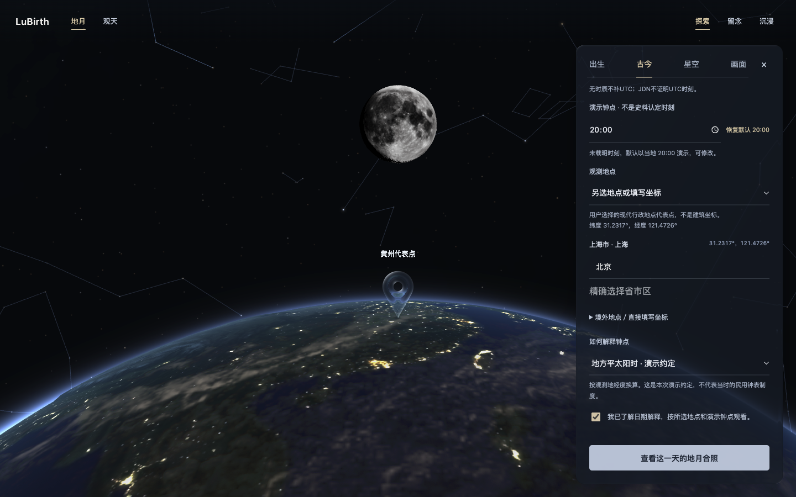

# LuBirth 前端独立审阅：Emil 设计工程视角

审阅日期：2026-10-28。审阅对象：`main`，`f9b653172642a3defd23debbea520586bdabfd3f`；浏览器证据由主线程从 `https://aitoshuu.me/LuBirth/` 采集。本审阅只写文档，不修改应用、不提交或发布，也不使用已归档的视觉实验分支。

使用技能：[`emil`](/Users/aitoshuu/.codex/skills/emil/SKILL.md) 路由到 [`emil-design-eng`](/Users/aitoshuu/.codex/skills/emil-design-eng/SKILL.md)。选择标准是交互可预测、反馈及时、状态清楚与界面协调；本轮不扩展成动画改造。审阅者独立阅读代码和已批准设计，未读取另一位审阅者的结论。浏览器由主线程在独立 Ego Lite 工作空间集中操作，本审阅者只读取共享证据，未控制前台或另开浏览器。

## 结论

当前网页已经把出生、历史、星图与留念接到同一份观察状态；默认地月合照也符合产品方向。主要问题不是缺少视觉装饰，而是地点输入的“正在编辑”与“已经选定”不一致，加上历史详情里的多层确认，使用户难以判断到底还差哪一步。

本轮手机视口的历史纪念卡首轮出现图片读取超时，后续重开成功生成预览；这不证明持续故障，但暴露了错误后的“准备中”反馈与恢复入口不清楚。未执行 PNG／ZIP 实际下载，不能据预览可打开就认定留念端到端全部通过。

应先解决地点状态正确性，再简化一次历史观看的流程。增加转场、按钮动效或说明文字不能代替这两件事。以下建议尚未实现；其中减少日期／地点确认步骤涉及现有交互契约，需在后续实现方案里明确确认语义，不能直接删掉史料精度要求。

## 范围与证据边界

| 证据 | 覆盖内容 | 不能据此宣称 |
| --- | --- | --- |
| 静态代码 | `App`、统一工作面板、历史表单、地点搜索／级联／坐标、观察状态、纪念卡上下文 | 所有 Safari／输入法行为已复现 |
| 已批准设计 | 10 月 23 日空间联动、10 月 24 日 UI 合并、10 月 26 日加载整理 | 允许改成另一种历史产品或恢复常驻水印 |
| 桌面／手机截图 | 1440×900 桌面、390×844 手机视口的当前公网画面，主线程提供，审阅者目视检查 | 手机真机键盘、Safari 触摸或页面性能已经通过 |
| 浏览器复现记录 | 见同目录 `assets/2026-10-28-lubirth/observation-evidence.json`，以记录中实际采到的路径为准 | 未列出的端到端、真机和天文数值已重新验收 |

截图只作为评审依据，不是新的设计稿。本轮不重新比较地球云层、月面材质或归档实验的性能。

### 已核对的实测事实

以下“实测”指主线程提供的浏览器执行记录；截图由本审阅者实际目视。JSON 的 case 编号和下文发现编号各自独立。

| 路径 | 实际结果 | 证据 |
| --- | --- | --- |
| 有代表点事件首次打开 | 承天寺夜游已填 `20:00`，地点模式为空、日期接受未勾、主按钮禁用；点黄州代表点一次即可选上，仍要另勾日期接受。 | JSON case E1；[详情顶部](assets/2026-10-28-lubirth/03-desktop-history-detail-top.png)、[观看参数](assets/2026-10-28-lubirth/04-desktop-history-confirmation.png) |
| 桌面主动作位置 | 1440×900 中，按钮初始纵坐标约 1245px，在首屏外；选择地点后面板内容高 1279px、可视高 734px，到提交区时滚动量 545px。 | JSON case E1；截图 03／04 |
| 一次选择并确认进入历史合照 | 观察为黄州代表点、`1083-11-30 20:00`、地方平太阳时，UTC 为 `1083-11-30T12:20:29.000Z`，来源 `event-default-20`。确实进入现有地月沉浸近景。 | JSON case E2；[历史合照](assets/2026-10-28-lubirth/06-desktop-history-immersive.png) |
| 关面板／分类往返 | 地点、钟点和日期接受保留，滚动回到顶部；返回目录再打开同条记录才重置地点与接受状态。不能把两种路径混称“关闭就丢”。 | JSON case E3 |
| 搜索候选一次点击 | 上海第一个候选一次点击即选定，坐标为 31.231706／121.472644；未复现必须反复点候选。 | JSON case E6 |
| 新查询与实际提交分离 | 已选上海后改打北京、blur，不选新候选，摘要仍上海，主按钮仍可用；随后 ArrowDown＋Enter 实际提交上海并关闭面板。 | JSON case E6；[新查询与旧地点同屏](assets/2026-10-28-lubirth/05-desktop-uncommitted-location.png) |
| 省／市部分编辑 | 已选上海后改省为广东，三级选择为广东／空／空，已选摘要仍上海，按钮仍可用；此路径未再次提交。 | JSON case E7；不要把界面状态证据扩大为再次提交的证据 |
| 手填坐标没有回填 | 已选上海时，坐标编辑的名称／纬度／经度全空；只填写名称后，已选地点被清空、按钮禁用，搜索框仍显示上海。 | JSON case E8；[已选地点与空坐标同屏](assets/2026-10-28-lubirth/07-desktop-selected-place-empty-coordinates.png) |
| 首次查询的键盘选择 | 搜索上海得到 17 个候选，ArrowDown＋Enter 没有选中地点，焦点仍在输入框，观察地点为空、按钮禁用。 | JSON case E5；仅桌面按键，未测输入法组合 |
| 无代表点人物 | 张之洞的时刻为空，地点需明确选；“当前地点”在刚看完历史之后指向黄州代表点。 | JSON case E4；前两项符合既定规则，后者文案宜写“沿用当前观察地点”，避免被理解为设备定位 |
| 历史观察成为出生表单初值 | `birth=null`、当前为历史事件时，重载 `?history=1` 后首次打开出生，显示 `1083-11-30／20:00／上海`，没有示例警告。未保存，不能据此说个人基准已自动被覆盖。 | JSON case E9；[历史初值进入出生](assets/2026-10-28-lubirth/08-desktop-history-prefills-birth.png) |
| 手机观看流程 | 390×844 视口无横溢；面板 366×608px，可视内容 550px，选择地点后的总内容 1275px，提交区滚动量 725px；初始按钮 y≈1389px。一次选黄州、勾日期说明、提交可正常进入合照。 | JSON case E10；[手机详情顶部](assets/2026-10-28-lubirth/09-phone-history-detail-top.png)、[手机观看参数](assets/2026-10-28-lubirth/10-phone-history-confirmation.png)、[手机沉浸结果](assets/2026-10-28-lubirth/11-phone-history-immersive.png) |
| 手机历史留念首轮失败 | “留念→纪念卡”正确选中 `same-moon`，但首轮合成等待后报图片读取较慢、保存 PNG 禁用、预览仍是 585×1266 的冻结原图，并显示“手写模板准备中”。没有实际导出。 | JSON case E11；[手机留念状态](assets/2026-10-28-lubirth/12-phone-keepsake.png)；尚不能定位网络、模板或解码原因 |
| 历史观察进入当地天空 | 黄州代表点、`20:00`、UTC `1083-11-30T12:20:29.000Z` 及事件来源保持，桌面／手机均实际出现观天场景与观察摘要。 | JSON case E12；[手机观天](assets/2026-10-28-lubirth/13-phone-local-sky.png)、[桌面观天](assets/2026-10-28-lubirth/14-desktop-local-sky.png)；URL 没写入 `scene=sky` 不等于导航失败 |
| 一次后续留念重开与恢复 | 场景可见就绪后重新打开留念，历史卡预览成功：585×1650、`same-moon`、有保存 PNG 链接、无错误；切回原图仍有 585px 宽的完整图片及下载链接。均未实际下载。 | JSON case E13；[重开成功的历史卡预览](assets/2026-10-28-lubirth/15-phone-keepsake-retry.png)；脚本误等 button 而成功实际为 link，等待超时不算第二次合成失败，也不算合成耗时 |

这张截图的关键不是输入框还缺一次点击，而是界面没有把“北京尚未选择”和“真正采用上海”作为待处理冲突阻止提交。

## 必须保留的产品契约

| 概念 | 当前应有含义 | 审阅要求 |
| --- | --- | --- |
| 出生 | 用户明确保存的个人时间地点 | 不能从历史浏览静默变成“我的出生” |
| 古今同月 | 选择具体地点和历史日期，沿用出生合照展示地球地点与对应月相 | 主结果仍是地月沉浸合照；观天是后续主动入口 |
| 观天 | 用同一观察状态进入当地天空 | 切换视图不另解释一次日期、时区或地点 |
| 中国星官／现代星座 | 同一天空的不同解释层 | 不自动重置时间地点，不把后世转绘冒充原代星图 |
| 合影位置 | 默认展示偏好，保证构图和沉浸 | 不以移动后的屏幕坐标重新计算月相；真实位置仍可主动切换 |
| 事件 20:00 | 仅缺时刻的具体事件，按所选地点和时间解释演示 | 人物出生／个人出生不套用默认值；不提升为史实 |
| 留念 | 冻结当前画面与观察上下文的输出 | 历史来源、演示时刻和代表点精度可追溯，后续浏览不污染已冻结卡片 |

依据：`docs/plans/2026-10-23-002-feat-earth-sky-spatial-link-plan.md:19–28,203–229`、`docs/plans/2026-10-24-ui-consolidation.md:19–28`。这里的“同月”不是“匹配相同公历月日便保证月相相同”；当前 `relationLabel` 已明确写“换算公历”，应保留。

## 优先问题与建议

优先级：P1 为可能保存错误地点或混淆个人／历史来源；P2 为明显阻碍观看、输入或理解；P3 为局部视觉打磨。`After` 均表示建议，不表示本轮已修改。

| 编号／级别 | Before | After | Why |
| --- | --- | --- | --- |
| E1 · P1 | 选定一个地点后，继续输入另一个名字，搜索文字变了，父级已选地点仍是旧值；改省／市也不使旧地点失效。 | 同一个地点编辑模型持有草稿、已选值与有效性；开始修改后明确进入“待选择”状态，不能默默用旧地点提交。 | 用户要的是新地点，实际保存却可能仍是旧地点。外观看似“还没确认”，实质是状态契约不一致。 |
| E2 · P2 | 已选地点与手填名称／经纬度是两套状态。坐标字段从空串初始化，修改一项可能把原地点清空。 | “直接填写坐标”从已选地点完整回填，编辑一项保留另外两项；无效草稿保留但不提交。 | 用户本想微调一个值，却被迫重新填写三个字段，正是多次输入的一种来源。 |
| E3 · P1 | 无个人出生基准时，出生表单可用当前历史观察作为初值；没有历史来源警示。 | 个人表单从个人草稿／个人基准初始化；无个人数据时显示明确示例或空草稿。历史转个人若允许，必须是明确动作。 | “看过一个历史事件”不等于“把这天当我的出生”。这是概念边界，不是配色问题。 |
| E4 · P2 | 进入历史记录后先读资料，再选地点模式，必要时选具体地点，确认日期说明，最后滚动到主按钮。时刻、默认来源、地点精度与时间解释分散多次出现。 | 用一个紧凑的观看参数区呈现“这条记录／日期解释／地点／20:00 演示”；保留一个主动作，少用选项折叠。明确的地点和日期接受语义保留。 | 观看被做成逐项手续，用户的注意力从事件、地点和月亮移到了填表。 |
| E5 · P2 | 返回目录会卸载记录表单；重新进入同一条记录，地点模式和日期接受状态重新开始。 | 保留同记录、同资料版本的当前会话草稿；回到已观看记录可清楚地“沿用这次设置再看”。不同记录仍重新初始化，资料变化须重核对。 | 不能把“新事件需要重新确认”扩大为“同一条记录返回一次也全部重做”。 |
| E6 · P2 | 搜索输入只有 Escape 专门处理；没有方向键候选选择、Enter 提交候选或组合框语义。历史模式下无障碍名称仍写“搜索出生地点”。 | 做成可预测的组合框：方向键浏览候选，Enter 选择，输入法组合期间不提交，Escape 先收起候选；名称随用途准确变化。 | 桌面键盘与手机“完成”键的心理预期是选地点，而不是跳到另一个确认阶段或提交旧地点。 |
| E7 · P2 | 自定义历史地点同时出现在外层经纬度说明、已选地点行、搜索框文本；进入沉浸后这些信息又全部收起。 | 编辑时只保留一个权威的已选地点摘要，坐标和资料精度按需展开；沉浸仍保持干净，通过“显示菜单”查看同一份简短观察摘要。 | 繁杂与缺少上下文是同一状态在不同阶段呈现不协调；不应靠恢复常驻水印解决。 |
| E8 · P3 | 桌面星官人物轮廓能穿过半透明侧栏，出现在输入和低优先说明后面。 | 仅提高工作面板局部背景对细线的抑制，检查各种亮背景下的输入与辅助说明；不关星空、不加多层卡框。 | 画面的特色应留在场景里，不与正在填写的内容争夺可读性。 |
| E9 · P2 | 纪念卡图片读取超时后，“保存 PNG”禁用，预览仍写“手写模板准备中”；提示重试，却没有重试动作。 | 分清准备、合成、失败与可保存状态；失败后直接提供重试同一草稿与保存原图，并在操作附近显示原因。 | 留念是沉浸体验的收束；状态含混会让用户把失败误认成仍在加载，或以为看到的原图已经是纪念卡。 |

### E1：输入的新地点与真正提交的地点可分离

代码锚点：`LocationSelector.tsx:108–118,143–154,156–178,211–221`；`ObservationForm.tsx:55,61–63`；`JourneyPanel.tsx:23–32,59`。

`handleSearch` 只改 `searchQuery` 和候选列表。父级 `observer` 只在点击候选或完整选定区县后更新。修改省份／城市也只改选择器内部字段。因此，“已选上海→输入北京但不点候选→blur→主动作”仍有旧上海可供提交；个人表单的初始示例地点同样会使这种情况更隐蔽。

上述历史自定义地点路径已有实际复现：输入框为北京、摘要仍上海、CTA 可用；ArrowDown＋Enter 最终把上海写入当前历史观察并进入合照，见 JSON case E6。省份切到广东后仍保留上海摘要且 CTA 可用也已实测，见 case E7，但没有再次提交该路径。个人初始示例路径属于同段代码的静态风险，不用推断冒充另一次实测。

这里不能把输入框有文字当成已经选择了有效地点，也不能自动把搜索首项当用户同意。建议明确一个地点草稿接口：显示文字、已选地点、是否待确认及错误，由搜索、级联和坐标共用。无需再加一个“确认地点”按钮；候选的一次选择就应完成地点提交。

这里“使旧值失效”指旧值不能继续作为本次提交地点，并不要求销毁最后一次已选值。可以保留其快照供撤销编辑；只要草稿待定，主动作就不能无声回落到快照。坐标编辑也遵循同一规则。

验收标准：

- 已选上海后输入北京但未选结果，主动作不能静默保存上海；界面明确指出“请选择候选地点”，并可撤销编辑。
- 改省或市但未完成选择，也不会提交旧区县。
- 单击一个候选即可得到可用地点；blur、关面板和切分类不要求再选一次。
- 主动作提交的名称、经纬度、地球标记、UTC 换算和留念元信息完全对应。

### E2：坐标编辑没有从现有地点回填

代码锚点：`ObservationForm.tsx:7–24`。

`ObserverPicker` 接收 `value`，但 `latitude`、`longitude`、`name` 三个字段均从 `''` 初始化。搜索选定地点后，顶部摘要有值，展开坐标仍为空。只编辑其中一项时，`updateCoordinates` 检查三个空串并调用 `onChange(null)`，使刚选定的地点失效。切离自定义模式再回来还可能出现“摘要有值、编辑字段为空”的脱节。

已实测前一条路径：上海选定后展开的三个字段全为空；只把名称填为“上海外滩（审阅测试）”，已选地点立即变为 null、主按钮禁用，而搜索文字仍是上海，见 JSON case E8 与截图 07。切模式重挂载属于静态可见风险，本轮没有把它列作另一次实测。

建议让坐标编辑草稿在进入编辑时取自选定地点；编辑未完成与清除地点分开。不要在每个不完整按键上把已选地点无提示地清空，也不要在草稿同步时覆盖用户正在输入的内容。

验收标准：已选上海后只改名称或经度，另外两项保持；切换模式往返仍能编辑同一组值；越界时保留草稿、指出对应字段，修正后一次完成。

### E3：个人出生表单与历史来源边界不稳

代码锚点：`App.tsx:36–38,93–99,210–215`；`ObservationForm.tsx:54–56,62,70`。

出生内容是延迟首次挂载、随后隐藏保留的表单，其初值为 `state.birth || state.current`。因此风险依赖入口：尚未挂载出生表单、没有个人出生基准、已进入历史时，首次打开出生会把历史观察作为输入初值；而页面先打开过出生时又保留之前草稿。这两条路径不一致。当前仅 `example` 来源有“上面是示例信息”的提示。

该入口已实测：会话中 `birth=null`、当前来源为承天寺夜游，重载 `?history=1` 后首次打开出生，表单为 `1083-11-30／20:00／上海市·上海`，没有示例提示，见 JSON case E9 与截图 08。测试没有保存，所以结论是危险初值和来源混淆，不是个人出生基准已经被自动覆盖。

同一段代码还有时间解释的静态风险：若初值来自地方平太阳时历史观察，出生表单的偏移会取默认 `480` 分钟；保留同样的钟面日期时刻再保存可能变成另一 UTC。此次没有通过保存来复现该后果，后续应与初值边界一起验收。

建议把个人草稿的生命周期与“当前在看什么”分开。保存出生仍保留一次主操作与沉浸取景；只是不能把历史浏览当成个人信息的隐式来源。

验收标准：无出生资料，从历史入口观看后首次打开出生，不会无说明显示历史人的生日／事件时间为个人输入；已有个人草稿在历史、星空往返后原样保留；刷新恢复历史会话也不混淆。

### E4／E5：多次确认先区分必要条件与重复劳动

代码锚点：`JourneyPanel.tsx:17–24,35–60,129–143`；`observation.ts:72–84`；`historyObservationPolicy.ts:6–14`。

当前事件已经默认填好 20:00，不需要再点“恢复默认 20:00”。按钮禁用主要取决于地点和日期接受。地点下拉框里的“另选地点”只选择了一条输入路径，不是实际地点；用户随后还要完成搜索或坐标输入。最后的勾选用于接受日期与演示解释，与选择地点确实不是同一件事。

当前普通观看表单还直接展示资料里的“无时辰不补 UTC；JDN 不证明 UTC 时刻”，随后又显示钟点标签、默认 20:00 来源、地方平太阳时说明和最后的确认。技术名词 JDN 不帮助普通用户选择地点。可在界面合并成一句准确的“未载明时刻，默认以当地 20:00 演示，可修改”，原始时间精度说明保留在资料详情，不删除源记录。

因此不能简单把所有步骤称作坏掉的“地点确认”，更不能删除日期精度约束。此次资料统计为 150 条：116 条已有代表点、34 条没有；60 个事件中 45 条有代表点、15 条没有。85 条记录的日期状态为条件性公历解释。代表点不是精确古建筑坐标，无代表点时也不能猜一个地点。

建议的后续观看流程：

1. 打开记录后优先看到这次将观看的日期、地点提案和默认时刻；其余出处仍可展开查看。
2. 有代表点时呈现一个可直接选择的地点提案；无代表点时明确选择“沿用当前观察地点”或另选。不要自动代替用户确定史实位置。
3. 有一句清楚的演示与日期说明，再执行一个主动作进入合照。若把勾选合并到 CTA，须让操作文字和可见说明明确承担日期／地点接受语义，并在后续设计中确认；不能只删勾选而仍写 `dateAcknowledged=true`。
4. 原记录返回后沿用本次会话草稿，并恢复该内容的合理滚动位置。当前实测分类往返虽保留值，却将历史面板从 `scrollTop=504` 复位为 0，又要求用户寻找参数。新记录可以回顶部，关闭再打开／切分类回来应与新记录区分。更换记录不继承确认，资料哈希变化重新核对。不要把上次事件地点变成下次事件的默认事实。

验收标准：有代表点事件不需搜索或手输地点；一次地点选择后不再二次确认同一个地点；手机主动作在参数区可直接触达，详情展开不吞掉草稿；返回同记录能继续原选择。所有入口仍标记演示 20:00、时间解释和代表点精度。

手机实测加重了这一判断：390×844 下，内容可视高 550px，完成地点选择后总高 1275px，本次到提交区时记录的滚动量为 725px。这不是最小所需滚动量的测量。流程可以完成，并没有横向溢出；问题是路径太长，不应写成按钮永远不可用或页面无法操作。

### E6：地点搜索应完成一次输入，而不是留下隐式提交

代码锚点：`LocationSelector.tsx:200–243`。

现有候选已经使用原生按钮，Tab 可以进入，焦点可见；Escape 会先关闭候选，并阻止冒泡。blur 逻辑也专门保留 Safari 点候选的 click，不能在没有复现时把旧的“blur 先卸载候选”问题重新认定为现存 bug。缺口在于没有候选方向键／Enter 选择状态，也没有组合框的 `aria-expanded`、关联列表和活动候选描述。

验收标准：输入后上下键能定位候选，Enter 选一次即可；候选打开时不会隐式提交外层表单；中文输入法候选确认不触发表单；Escape 先关闭搜索，再关闭工作面板；触屏点候选一次立即生效。真机输入法及 Safari 行为需要单独验证，尺寸模拟不能替代。

### E7：让历史上下文贯穿输入、合照、观天、留念

代码锚点：`JourneyPanel.tsx:49–51`；`ObservationForm.tsx:16–24`；`App.tsx:202–208`；`SimpleTest.tsx:1820–1825`；`keepsake/draft.ts:55–73`。

当前自定义地点的经纬度和名称有重复呈现，而合照沉浸时会收起说明。这不是恢复常驻长说明的理由；“沉浸时干净”是已批准要求。应在生成前建立明确预期，按需打开菜单时再准确看到当前历史事件、日期、地点与演示来源。不要把历史主结果改成观天，也不要增加一个新面板。

留念已正确冻结观察、校验当前渲染状态，并把历史卡默认寄语选为“与古人同望”，默认保留演示来源。可进一步评估历史卡默认显示地点：当前所有卡的 `showPlace=false`，输出上首先丢失的恰好是“在哪儿同望”。这属于呈现建议，不能当作已确认的新默认。

验收标准：编辑时一个已选地点摘要足够说明实际采用的地点；显示菜单后能核对同一份上下文；从历史合照进入观天不换时间地点；留念标题、日期、演示说明与实际场景一致。始终保持默认合影、现有蓝色弧光与干净沉浸画面。

### E9：纪念卡失败反馈和恢复路径不清楚

代码锚点：`keepsake/compose.ts:7–21,34–41`；`KeepsakeEditor.tsx:20–21,29–48,79–82,104–112`。

首轮已实测一次失败：历史合照打开留念后切到纪念卡，默认寄语正确，但当次最终只显示原图，“保存 PNG”禁用，并有“图片读取较慢，请稍后重试”，见 JSON case E11。这一次不能列为卡片生成通过，失败原因尚未确定。

一次后续重开确实恢复：显示“与古人同望 · 地月纪念卡”的 585×1650 预览，`same-moon` 保持、保存 PNG 链接可见、无错误，见 case E13 与截图 15。原图恢复入口也有完整图片和下载链接。因此结论不是持续无法生成；本轮暴露的是首轮超时及其失败反馈／恢复体验。两次都没有触发实际 PNG 或 ZIP 下载。

静态可确认两件事：

- 合成同时读取原图 data URL、手写卡面图、标识图，三个 `loadCardImage` 都以 15 秒为上限并共用超时消息。单凭这条消息不能推断是哪一张、网络还是浏览器解码失败；也不能认定整个公网都不可用。
- `prepared` 仅判断模板清单里是否存在条目。捕获错误后 `image=null`、`working=false`，预览分支仍写“手写模板准备中”，与已发生的失败矛盾。界面没有明确重试按钮，切换格式或改变选项才会重新触发合成。

当前源码没有普通文字纪念卡的自动兜底，只保留冻结原图，并能切回“原图”保存。不能把原图回退当成卡片已生成，也不能假设可以原地导出一张普通文字卡。

“使用普通文字排版”只是署名输入下的 `<small>` 说明，不是 checkbox 或降级开关。真正的两个 checkbox 是显示钟点／显示地点；改变这些项仍会读取同样的原图、手写 SVG 和标识 PNG。`CardOptions` 没有普通文字兜底选项。

case E13 的“观天→地月→立即点留念”操作先遇到“截图失败，请稍后重试”，尚未进入卡片合成，不能算第二次合成失败；等地月场景可见后再次点击可恢复。静态上确实存在就绪窗口：`App.tsx:198` 只要 `view=earth` 就显示按钮，`SceneScreenshot.tsx:46` 只按 `capturePending` 禁用；截图函数却由画布内部 `RenderRuntime.tsx:105–191` 的 effect 注册／卸载。没有捕获当时的异常栈，不能认定这个窗口就是弹窗原因，但应把切景期间的按钮就绪反馈纳入后续验证。

重开成功后，测试脚本仍在等待“保存 PNG”按钮；成功状态实际渲染的是链接，所以该等待超时属于测试条件不匹配。不能写成第二次合成失败，也不能把这个 25 秒等待作为实际合成耗时。

验收标准：切景后留念入口与实际可截图状态对齐，必要时显示准备中；明确区分资源缺失、正在合成、合成失败与可保存；失败提示在当前预览／保存动作附近可见；一次明确重试保留同一事件、地点、月相截图和寄语；失败状态直接可保存原图；成功生成并实际导出 PNG 后，才能把卡片流程列为通过。不要为掩盖失败静默更换历史模板、删掉演示说明或重取另一帧。

## 应保留的已有优点

| 已有行为 | 证据／代码 | 保留原因 |
| --- | --- | --- |
| 一条工具栏、一个工作面板、四项同级 | 桌面截图 01／02；`ExperiencePanel.tsx:34–55` | 已明显控制层级，不应为本轮问题再加一套导航或卡框。 |
| 保存出生与合照取景是一次主操作，历史也进入相同构图 | `App.tsx:93–99` | 这正是概念一致性的正确基础。 |
| 共享 Observation，个人与历史分开保存，星图偏好不篡改观察 | `journeyStore.ts:54–75` | UI 修复不应创建第二套 UTC／地点或月相状态。 |
| 事件缺时刻默认 20:00，并有结构化来源 | `historyObservationPolicy.ts:6–14`、`observation.ts:63–69` | 不再让用户为系统已决定的默认时刻增加一次点击。 |
| 面板键盘分类、焦点恢复、候选 Escape 和减少动态 | `ExperiencePanel.tsx:17–32,40–48`、`LocationSelector.tsx:204–209`、`experience.css` | 已有的基本工程质量，应补完整而不是整体重写。 |
| 手机输入字号、常用主操作高度与安全区适配 | `experience.css` 的 600px 规则；按钮最低 44／46px | 可以在当前结构里修正流程，不必换 UI 库。 |
| 纪念卡冻结草稿、本地生成、撤销异步合成与 URL 回收 | `SceneScreenshot.tsx:65–75`、`keepsake/draft.ts:39–53`、`KeepsakeEditor.tsx:29–48` | 已考虑状态正确性和资源释放，不应因视觉精简删掉。 |

## 建议交付顺序及边界

| 顺序 | 目标模块 | 需要先明确的接口／验收 |
| --- | --- | --- |
| 1 | `LocationSelector`、`ObserverPicker`、出生／历史表单 | 一个已选地点与一个可编辑草稿；新输入何时使提交失效，坐标何时回填；E1／E2／E6 用同一组桌面与手机路径验收。 |
| 2 | `App`、个人出生草稿 | 个人初值与当前历史状态解耦；E3 的首次挂载、刷新与已有草稿三条路径。 |
| 3 | `JourneyPanel` 历史草稿与观看参数区 | 同条记录保留，跨记录／资料变化重新接受；明确一主动作如何承接日期／地点确认，E4／E5。 |
| 4 | 观察摘要、留念上下文、局部面板背景 | 不增加常驻文字、卡框或渲染上下文；E7／E8 以同条件截图和可读性核对。 |
| 5 | `KeepsakeEditor`、`composeBirthCard` 的加载和恢复状态 | 先定位本轮卡片超时，再明确重试、原图退路与实际导出验收；E9。 |

这不是改代码的授权，也不包含 commit、push 或部署。无论后续采用哪种交互，不能跳过日期／地点精度检查，不能把月球切为默认真实位置，不能为了“夜晚氛围”改变真实日照或事件钟点。此次未做性能基准、完整天文回归、物理 iPhone／Safari／中文输入法真机测试，不能把本次评审当作这些项目的验收通过记录。
