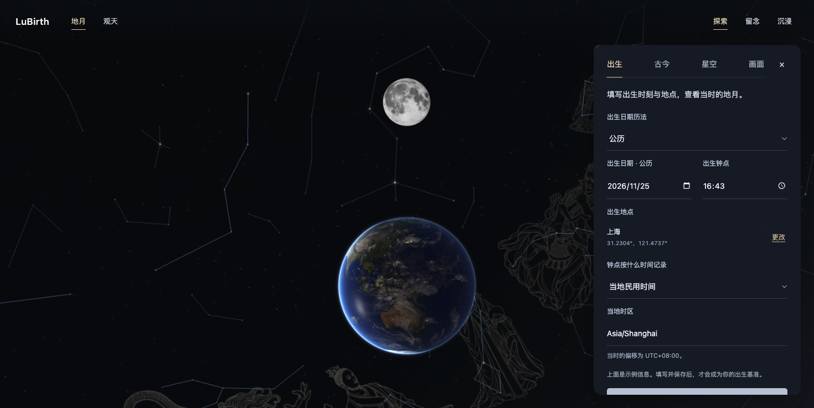
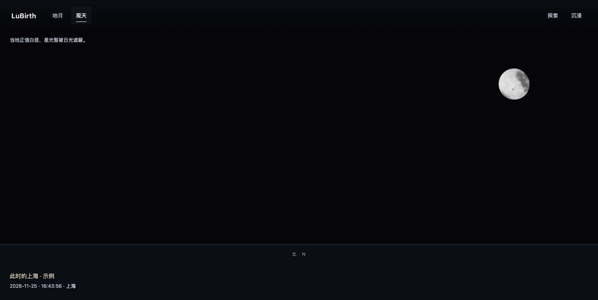
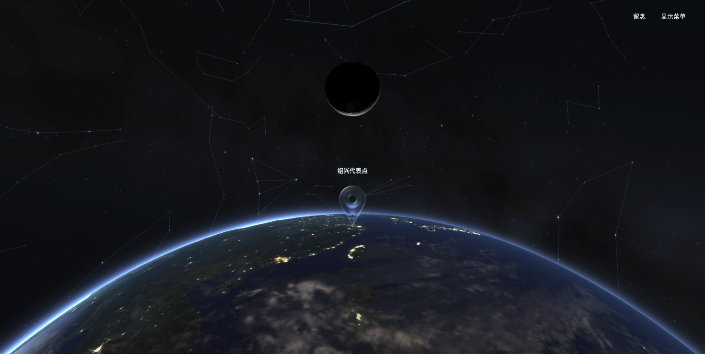
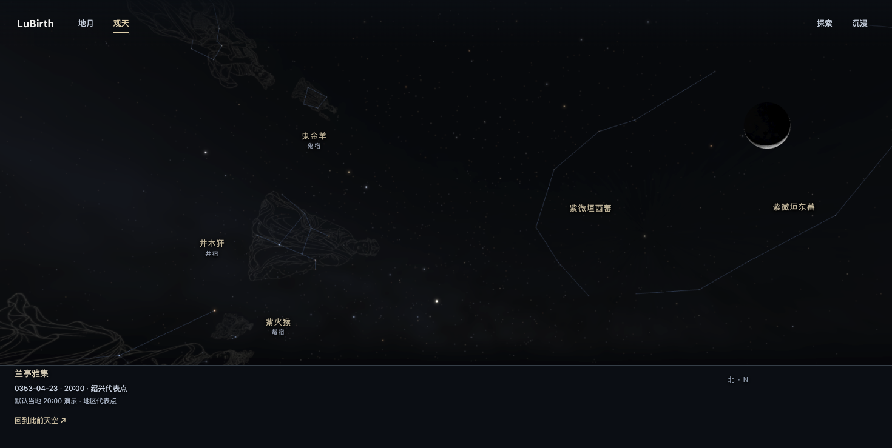
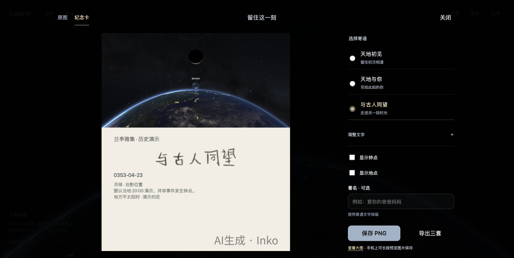
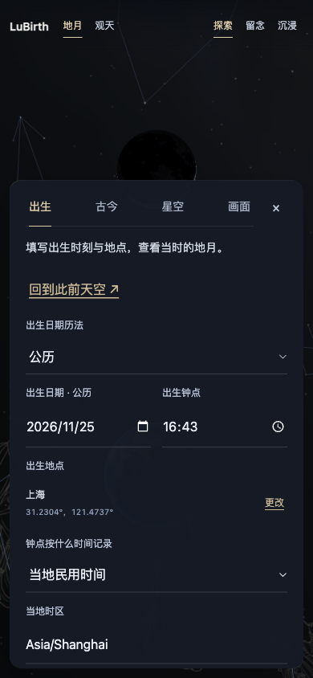

# LuBirth 深度审核与迭代方案

2026-11-25 · 原始审核与截图基于 `2602fd5a`。本轮开工前以 `main@96d74290` 核对方案。截图来自本地 Vite（桌面 1470×739，手机 390×844），存放在 [`assets/2026-11-25-deep-audit/`](assets/2026-11-25-deep-audit/)。

## 总评

现代公农历换算通过了逐日核对，现代日月位置、月食与月面朝向有独立对照。古代观测仍受史料、记时习惯和地点精度约束。下一轮优先修正古夜画面、纪念卡上的时刻说明和白昼观天体验。

| 维度 | 评价 | 一句话 |
| --- | --- | --- |
| 天文计算 | 很好 | astronomy-engine 加完整坐标链，并和 Stellarium、Horizons 做过对比 |
| 历法 | 好，覆盖偏窄 | 1901–2100 年准确；清代农历无法输入 |
| 史料日期 | 有明确的证据边界 | 153 条规范日期的日序计算一致，79 条日期仍保留条件性解读 |
| 地理 | 仍需补证 | 澳门和邢台的指定点位已复核，古今目录仍有 27 条缺预设观测点 |
| 时间换算 | 历史时制需核实 | 早期 IANA 数据代表特定城市。具体地点的钟点以当时的记时依据为准 |
| 审美 | 素材好，整合弱 | 审核截图里古代画面有现代灯光、白天是黑底、蛾眉月暗面过黑，纪念卡的地点和说明层级可精简 |
| 交互 | 通顺但偏重 | 先表单后画面，术语太多 |
| 工程 | 需要整理 | 图绘素材太大、主场景文件太长、仓库里有构建产物 |

**最优先的五件事**

1. 以观测地日期判断古夜画面，1900 年前关闭现代城市夜光贴图的亮点与光晕，保留夜面轮廓和蓝色弧光。
2. 修正旧经度兼容入口把四位早年误读成 1900 年代的问题，在交接文档里写清 IANA 时区、显式偏移与地方平太阳时的用法。
3. 观天按同一观测时刻的太阳方位和高度表现白昼与晨昏，保留默认合影和可选的真实位置。
4. 纪念卡使用干净取景，有原历依据时优先显示原历，沿用该观测的钟点出处和演示说明，保留 Inko 标识与元数据。
5. 按重新核对的缺地点清单逐条补证，光绪生日并列故宫两份材料的记载。

## 准确性审核

冻结的 150 条导入史料与补录合计 153 条，运行时再叠加场址、原历与时间证据。底表的 `productionReady:false` 是导入状态。合并后仍有 27 条缺预设观测点，79 条日期保留条件性解读。日序一致性用于检查转换后的内部数据，史源可信度还要逐条核对。

| 维度 | 核验方法 | 结果 | 存疑或缺口 |
| --- | --- | --- | --- |
| 历史日期 | 153 条独立推算儒略日编号（JDN），含日干支的原文另作核对，抽查约 60 条史料 | 日序与现用日期编码一致 | 光绪生日有两种公开记载，79 条西历日期仍按前推格里高利历作条件性解释 |
| 历法 | 对照香港天文台年表及 `scripts/test-lunar-calendar.mjs` | 1901–2100 年 73,049 天逐日核对。近午夜例子已并列历表初一与推算朔 | 现代农历输入限公历 1901–2100 年，清代历法扩展需确定历表范围 |
| 天文 | 坐标系回归及 NASA、JPL 数据对照 | 共享时空坐标接入天平动。2001–2100 年食典的 228 场食甚分类一致 | 真实的近地平显示采用标准海平面折射，几何坐标单独保留。少数临界月全食时长仍有偏差 |
| 地理 | 按出处核对行政区、历史场址与代表点 | 澳门、邢台已复核指定地点，康熙、同治、皮亚齐已有场址 | 27 条缺预设点。多个历史记录仍使用同一城市代表点，不能确定事件现场位置 |

**光绪帝生日。** 目录采用故宫人物页所载同治十年六月廿六（1871-08-12）。故宫大婚资料另记六月廿八（1871-08-14）。补证时保留两份材料和当前演示所采用的日期。 [故宫人物页](https://www.dpm.org.cn/court/lineage/226254.html?hl=%E6%85%88%E7%A6%A7) · [故宫大婚资料](https://www.dpm.org.cn/court/event/159203.html)

**缺坐标的高曝光条目。** 雍正、玄武门之变、陈桥兵变、达尔文出生地、伽勒发现海王星可优先核对。记录的地点名称只到城市或旧址范围时，展示相应精度。明确到建筑的条目应核对所记年代和场址，例如柏林旧天文台。

**口径建议。** 每条记录的“地点精度”应该如实显示“城市代表点”还是“具体建筑”。用户点开吴淞或徐家汇时，不应该看到上海市中心的坐标却以为是现场位置。

## 时间与时区

出生表单默认按所选地点的民用时制处理。大陆多数候选预填 `Asia/Shanghai`，新疆已可选择北京时间或新疆时间。用历史年份时，IANA 的代表城市规则有明确的资料范围。 [IANA 时区数据库说明](https://data.iana.org/time-zones/tzdb/theory.html#scope)

| 场景 | 现在给出的偏移 | 核对口径 | 差异 |
| --- | --- | --- | --- |
| 1900 年成都出生 | +08:05:43（上海地方平太阳时） | 成都代表点的地方平太阳时约 +06:56 | 约 70 分钟，原记录的钟制仍待考 |
| 1942 年夏季重庆出生 | +09:00（上海规则） | 重庆当年地点与记时依据应单独核对 | 一旦按错时制，可能出现小时级偏差 |
| 1930 年乌鲁木齐出生 | 默认 +08:00，可选 +06:00 | 由用户按记录实际使用的钟制选择 | 两个选项相差两小时 |
| 1986–1991 年大陆夏令时 | 按日期查询当地民用时区 | 已覆盖跳过和重复钟点的选择 | 继续回归具体日期 |

**改法方向**

- **历史时制按依据选择。** 文书给出可靠钟制时采用该口径。证据不足时可选择地方平太阳时作为演示，保留说明与已保存 UTC。历史时制提示按地区、日期和证据触发。
- **真太阳时作为独立选项设计。** 先定义时差、输入日期与跨日行为，并为具体史料标注记时依据。
- **旧换算分步校正。** 本轮修复 `toUTCFromLocal` 将四位早年转成 1900 年代的问题，兼容现有裸日期和明确 UTC 或偏移。旧调用方逐步改用明确时制后再移除经度推算。同步更新 `CLAUDE.md`。
- **清代历法单独扩展。** 先确认 1644–1645 年换历规则、清历与南明历并存时的选择方式，以及和 1901 年现代历表的衔接。用带原历出处的生日、闰月和跨年做交叉验证。 [Y.T. Liu 历法分期](https://ytliu0.github.io/ChineseCalendar/faq.html)

## 审美与视觉

画面的素材和概念是好的，写实地球、宋代星官线描、手写寄语这三样都有辨识度。问题在于三套视觉语言各自为政，而且最动人的几个时刻（黄昏、蛾眉月、古人的夜）恰恰最弱。

### 最该先改的五处

| 问题 | 在哪里看到 | 为什么要紧 | 方向 |
| --- | --- | --- | --- |
| 古代场景亮着现代城市灯光 | 兰亭雅集（353 年）地月合照，长三角、台湾、日本一片灯火（图 3） | 错置的现代灯光也会被印进纪念卡 | 1900 年前关闭现代夜光图及光晕。1900 年是画面展示门槛。按年代还原近现代灯光需要另找数据 |
| 蛾眉月暗面过黑 | 兰亭三月初三（图 3、图 4） | 蛾眉月的受光面积小，暗面轮廓影响月相辨识 | 后续调校已有地照与边缘过渡，真实位置保留月盘对背景星光的遮挡 |
| 白天的观天是一块黑屏 | 上海 16:43（日落前十几分钟）：纯黑天空加一行“星光暂被日光遮蔽”（图 2） | 很多人的出生时刻在白天，现在他们点“观天”看到的是一块黑屏 | 按太阳高度连续过渡天色，近地平线的暖光随太阳方向移动，星光随天色转暗逐渐显现。月面按相位呈现，真实位置遵守地平线规则 |
| 观天合影月球容易被读成方位 | 拖动星空时，合影月球停在原处（图 4） | 屏幕取景与真实天球方位需要能看懂 | 地月、观天均默认合影，提供真实位置与定位月球，沿用同一观察时刻 |
| 纪念卡像一张单据 | 兰亭纪念卡：地图图钉和“绍兴代表点”被印进照片；主日期是“0353-04-23”；三行演示说明占核心位置；右下角 AI 标识很大且显得突兀（图 5） | 这是用户唯一会带走、会分享的东西 | 见下文“纪念卡” |

图 1 首屏 · 图 2 白天观天 · 图 3 兰亭地月合照 · 图 4 兰亭观天 · 图 5 纪念卡 · 图 6 手机首屏 · 图 7 古今记录

### 整体视觉语言

- **定一个主调：“古籍星图里的写实天地”。** 现在同一幅画面里有三种线条：西式星座的蓝灰连线、宋代图绘的米色线描、UI 的金色强调。建议地月视图默认只留一种星线（跟当前文化走），线条不透明度降到现在的一半左右，让地球和月亮成为唯一的主角。
- **构图别居中对称。** 默认地月画面是月亮在正上、地球在正中，像教科书示意图（图 1）。将地球放在下三分之一、略偏一侧，月亮放在对角的三分线上，会更有电影感。兰亭那张“地平线弧 + 地点亮点”的近景已经很接近了（图 3），可以作为所有合照的基准构图。
- **地点标记改成光点。** 玻璃质感的地图图钉是导航软件的语言，和写实地球不搭。改成地表上的一个暖色小光点加一圈缓慢扩散的光环，文字标签只在悬停或刚进入时出现；纪念卡和沉浸模式里不显示标签。
- **地平线要有空气。** 观天的地面现在是一条硬灰线加一块平板，还被信息栏占满。建议在地平线上方加一层气辉和大气消光渐变；地面用极暗的远山剪影，不用做地形。信息不要底板，直接悬浮在剪影上。
- **文字要有中文气质。** 全站都是系统无衬线体，只有加载页用了宋体。建议事件名、人名、原历日期、星官名改用一款宋体或楷体（按需子集化，控制在几十 KB），表单和说明文字继续用无衬线体。“兰亭雅集 · 永和九年三月初三”用宋体展示，气质会完全不同。
- **先显示原历，西历放在后面。** 列表、观天信息栏、纪念卡里的主日期现在都是“0353-04-23”。中国史料应该先显示“东晋永和九年三月初三”，再用小字标“公元 353 年 4 月 23 日”；年份前面的 0 也要去掉。
- **主按钮看起来像不可点。** “观看地月合照”“保存 PNG”是灰蓝底色加深色字，暗色界面上像禁用状态（图 5、图 7）。主操作可以用已经在用的金色强调色，只用在这一个按钮上。

### 纪念卡

- **照片要干净。** 导出时不要带地图图钉和“代表点”这类界面元素。可以做成拍立得式内嵌照片，四周留相纸边，比上半张黑、下半张米白的硬切更有物件感。
- **内容层级优先寄语与原历日期。** 同一张卡保留公历换算日期、选中的显示项和必要的演示依据。国会图书馆 09:00、广州起义 17:30 应随观测标为史载钟点。史载时段、相关时刻与确实缺时段的晚 8 点各用对应说明。
- **Inko 标识与排版一起验收。** 保留现有导出中的显式标识和 PNG 元数据。标识大小按当前 `layoutInkoLabel` 基于输出短边计算，独立于脚注字号。 [图像标识标准](https://openstd.samr.gov.cn/bzgk/std/newGbInfo?hcno=F32EA2A561F1886CD8D606513512D547)
- **手写寄语和空白。** 手写字是好点子，但下方大片空白没有被利用。可以把当日月相画成一枚小小的水墨月，放在寄语旁边，把卡片和“那天的月亮”这个核心卖点连起来。

### 手机端

- 审核截图中手机首屏大部分被出生表单覆盖（图 6）。首访先看到场景，直接通过工具栏「填写时刻」打开现有工作面板。
- 桌面端 739px 高的窗口里，出生表单的保存按钮在可视区外（图 1）；手机上更是如此。主按钮应该固定在面板底部。
- 减少动态效果已有 CSS 和运行时支持。新增的首屏和天色需验证该设置，以及手写开场和场景就绪的衔接。

## 交互、信息架构与文案

流程是通的，但用户在看到美之前先撞上了表单和术语。主线应该是“先惊艳、再输入、最后带走”，现在是“先表单、再画面”。

**首次进入**

- 首次进入先露出地月画面，工具栏就绪即可打开表单。示例保持明确的城市与示例标记，原有手写加载随资源就绪结束。
- 出生表单优先展示日期（公历或农历）、钟点和地点。拟将时制和时区收在「高级」，遇到夏令时跳过或重复钟点、记录所在地和年代的时制缺少依据等情况时展开。

**导航结构**

- 工作面板沿用已确认的出生、古今、星空、画面四项同级结构。继续减少面板里的重复信息与确认动作。
- 沉浸仍是独立的观看入口，环绕或一夜快放可另作主动开启的体验。

**古今列表**

- 筛选有三层：3 个快速浏览、一排 7 个分类、一个下拉框，桌面端的“收藏”还单独换了行。建议合并成一排，把“历史上的今天”和“与我同月同日”放在最前面。这两个是最强的情感钩子，现在却排在第二层。
- 每条记录加一枚当日月相小图。这样浏览列表本身就在讲“那天的月亮”，也能让列表不像数据库。
- “可直接看 / 选地点”继续显示是否有预设观测点。已核实场址可直接观看，其余记录维持一次明确地点确认。

**文案替换建议**

| 现在 | 建议 |
| --- | --- |
| 绍兴代表点 | 绍兴（取城区位置） |
| 演示 UTC 按所选经度换算 | 按当地太阳时间推算 |
| 钟点按什么时间记录 · 当地民用时间 | 出生证上的时间（默认） |
| 月球 · 合影位置 | 月亮位置为构图调整 |
| 当地正值白昼，星光暂被日光遮蔽。 | 做了白昼天色后就不需要这句话；可以提供“看看这一夜的星空 →” |
| 北 · N | 北（全站只用中文方位） |
| 0353-04-23 | 永和九年三月初三 · 公元 353 年 |

手机端的出生标签页里还会出现“回到此前天空 ↗”，这是从古今带过来的状态，放在出生表单里让人摸不清指的是什么。

## 性能与工程

性能上最大的问题是星官图绘：56 张线描 PNG，每张 2.4–2.9MB，而地月默认画面就会用到其中几张。工程上最大的问题是 `src/SimpleTest.tsx` 一个文件有 3924 行，而且没有统一的自测入口。类型检查（`tsc --noEmit`）是通过的。

| 项 | 现状 | 方向 |
| --- | --- | --- |
| 星官图绘 | 56 张 PNG，单张约 2.5MB；构建产物 `dist/assets` 共 125MB | 线描适合转成单色 WebP/AVIF 或矢量图，预计能压到十分之一以下；按视野分级加载，先加载低清版 |
| 星表和银河 | `MilkyWay` 代码块 1.1MB，`moonPhaseCalculator` 660KB | 数据改成二进制或 JSON 按需请求，不要打进 JS |
| 主场景文件 | `SimpleTest.tsx` 3924 行，内含调试面板、自动测试、旧的时间换算 | 拆成地球、月球、相机、调试面板几个文件；调试部分只在开发环境加载 |
| 日志 | `src` 里约 200 处 `console.log`，`toUTCFromLocal` 每次调用都打两行 | 统一走项目已有的 logger，生产环境静默 |
| 类型 | 约 236 处 `any` | 优先清理天文和时间相关的模块 |
| 自测脚本 | 按功能独立运行。历史底表再生成依赖上游快照，月球实景校验以浏览器采集的 JSON 为输入 | 后续整理统一入口，标明每组测试的输入，保留本轮 Astra 独立验收与场景实绘 |
| 仓库卫生 | `.gitignore` 只有 2 行；`dist/` 的 29 个文件和 `.DS_Store` 在版本库里；本地仓库打包体积 492MB | 把 `dist/`、`output/`、`.playwright-cli/`、`__pycache__/` 加进忽略列表并移出版本库；发布产物本来就按 release ID 管理，不需要提交到 git |
| 根目录 | 11 份报告类 Markdown 堆在根目录（修复报告、诊断、Bug 指南等） | 移到 `docs/archive/`，根目录只留 README 和 CLAUDE.md |

## 迭代路线图

本轮分三批提交，分别经 Astra 独立验收后推送。后续保留数据、历法与性能方向。

| 阶段 | 目标 | 内容 | 验收 |
| --- | --- | --- | --- |
| 1．古夜和旧时间 | 修正夜光表现及早年兼容入口 | 地月用观测地日期决定现代夜光强度。兼容解析保留四位年份与 UTC 偏移 | 查看兰亭原图。让同一 UTC 分别落在当地 1899 年末、1900 年初，比对夜光和蓝弧。另验 0053 年、0099 跨 0100、明确 UTC 和偏移输入 |
| 2．纪念卡 | 输出干净画面和有据可核的日期、时刻 | 纪念卡按同一观测快照和对应史料版本显示原历、换算日期与时刻依据 | 检查原图与卡片取景、旧草稿、时段日界与记时制说明、三款模板、PNG 与 ZIP 元数据 |
| 3．观天及文档 | 白昼和晨昏分明，首屏先露场景 | 用共享太阳方向和太阳高度驱动天色，沿用按需渲染。首访使用既有入口打开表单。台账更新到开工基线 | 桌面与 390px 验证白昼、日落、三个晨昏边界、深夜与拖动方向，复核静止帧和合影、真实、沉浸入口 |

后续优先核对缺地点的高曝光记录和光绪生日两种说法。清代历法与真太阳时需分别定义数据和换算。星官图绘先量冷启动实际传输量与静止帧，再决定压缩格式和加载层级。仓库构建产物、根目录整理和更大的视觉改版另有独立验收。
