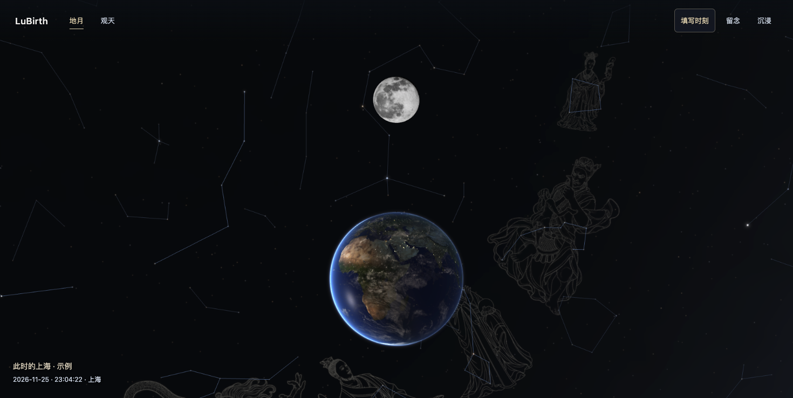
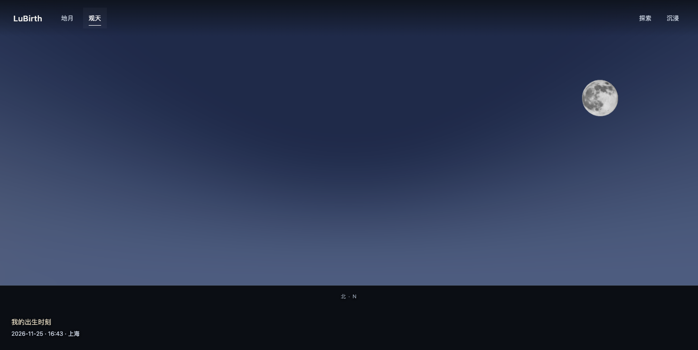
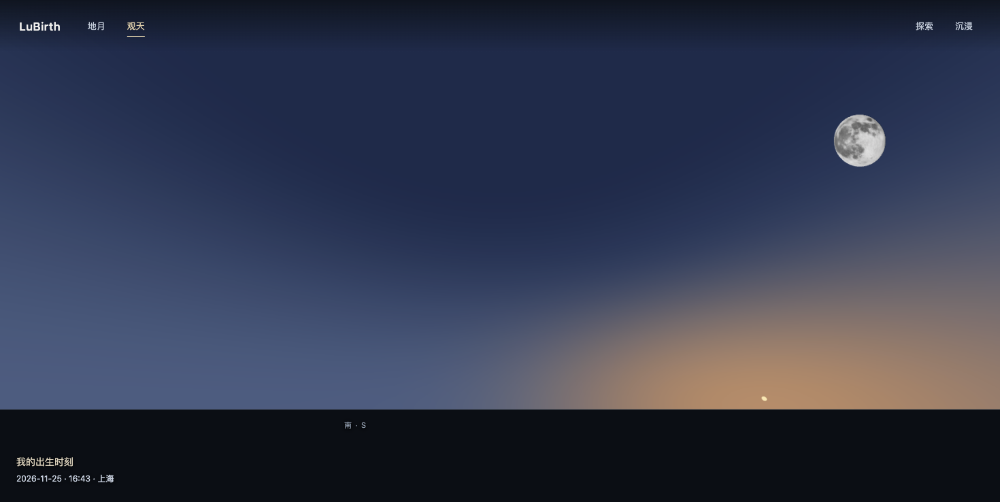
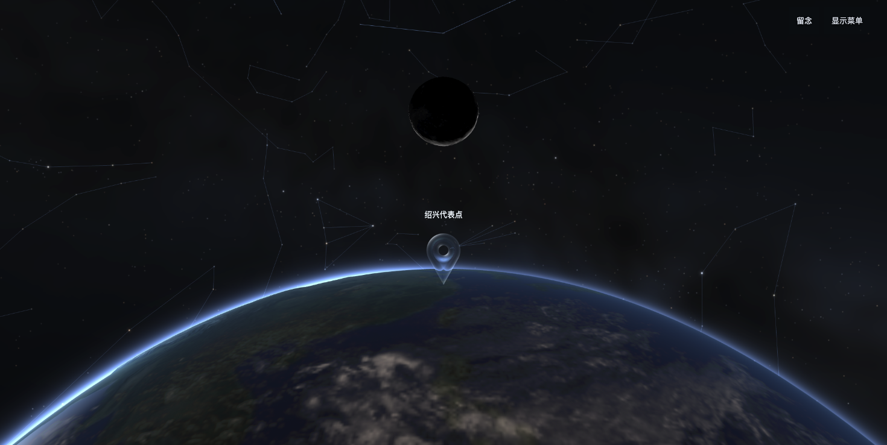
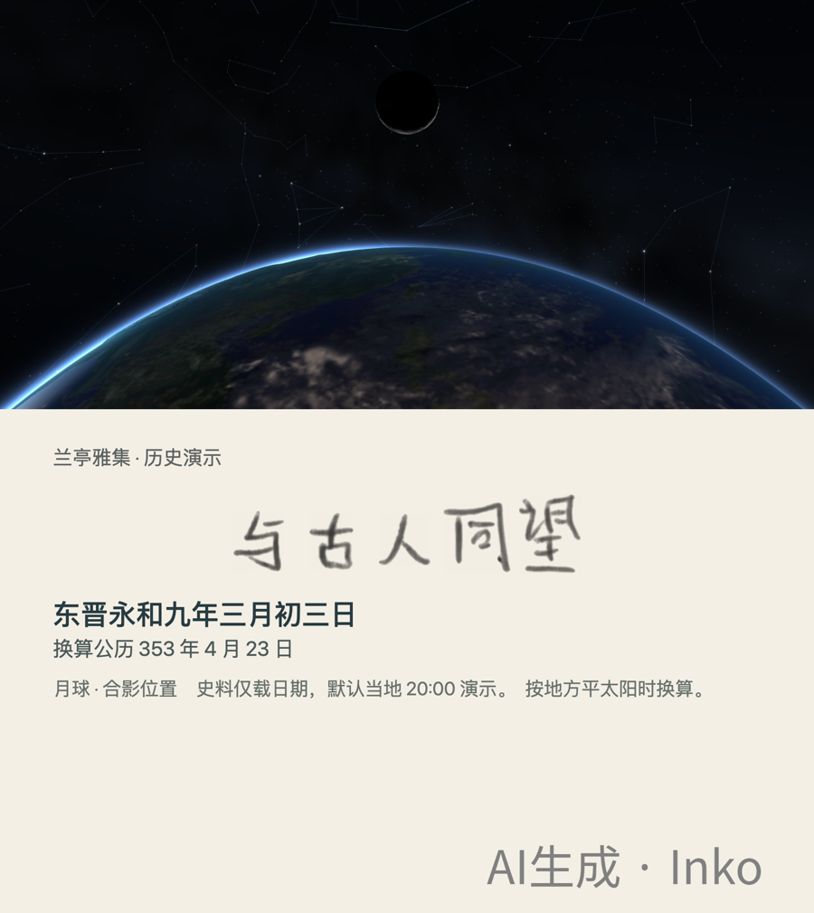

# LuBirth 第二轮复核

2026-11-25 · 对照 [深度审核与迭代方案](2026-11-25-lubirth-deep-audit-and-roadmap.md) 复核 `0924994c`、`9e675e53`、`3f0105fe` 三个提交。截图来自本地 Vite（桌面 1470×738），存放在 [`assets/2026-11-25-round-2/`](assets/2026-11-25-round-2/)。

## 结论

路线图三个阶段都已落地，主要验收点在画面上成立。

| 验证项 | 结果 |
| --- | --- |
| 相关测试 | `test-history-observation` 14 项、`test-keepsake-templates` 8 项、`test-sky-spike` 14 项、`test-lunar-calendar`、`test-civil-time` 全部通过 |
| 类型检查 | `tsc --noEmit` 无报错 |

下一轮优先处理两类问题：

- 本轮新做出来的画面还差最后一道打磨，包括太阳、月亮暗面和寄语底块。
- 方案里还没开工的文案和视觉语言。

## 已完成

| 阶段 | 审核时的问题 | 现在 | 证据 |
| --- | --- | --- | --- |
| 1 古夜 | 兰亭画面亮着现代城市灯光 | 按观测地日期，1900 年前把 `nightBoost` 置 0。光晕乘以 `nightBoost`，一起消失；蓝色弧光保留 | 图 3 |
| 1 旧时间 | `Date.UTC` 把 0–99 年读成 1900 年代 | 改用 `setUTCFullYear`，并补测 0001、0053、0099 跨 0100、1900，以及带偏移和 Z 的输入 | 测试 |
| 2 纪念卡 | 卡片印进地图图钉和“代表点”；主日期显示为 `0353-04-23` | 同一帧分别读出干净画面和原图。原历日期大字在前，换算日期显示为“353 年 4 月 23 日”。钟点说明按史料来源细分，草稿按 `recordHash` 匹配 | 图 5 |
| 3 观天 | 白天看到一块黑屏 | 按太阳高度连续过渡天色。日落方向有暖光，月亮未受光的部分叠加天光，“星光暂被日光遮蔽”的提示已删 | 图 2、图 4 |
| 3 首屏 | 表单盖住场景 | 首访先看到地月。“填写时刻”按钮用金色强调 | 图 1 |
| 文档 | `CLAUDE.md` 还写着按 15 度经度算时区 | 已改为按 IANA 时区或地方平太阳时，旧的经度推算只作调试兼容 | — |

## 本轮改动需要再修的地方

### 1. 寄语字后面有浅色方块（纪念卡，优先）

图 5 里“与古人同望”每个字后面都有一块比卡纸略亮的矩形。原因在素材本身：`public/keepsake/templates/v1/same-moon.png` 共 169,689 个像素，其中 38,184 个的 alpha 在 1–9 之间。这是抠图残留的纸色底块，叠在 `#f4efe5` 卡纸上就显出方块。

- **修法：** 素材里 alpha 低于约 12 的像素一律清零，或者重新导出；另外两套寄语一并检查。
- **验收：** 在 `test-keepsake-templates` 里断言低 alpha 像素占比，防止再出现。

### 2. 蛾眉月的暗面还是一块黑盘（地月、纪念卡）

兰亭初三的月亮（图 3、图 5）几乎是一个纯黑圆盘，压在星线上，读起来像个洞。三日月的地照在实际观测里很明显（达·芬奇辉）。

- **修法：** 把地照提到暗面可辨的程度，大约是背景亮度的 2–4 倍、偏冷灰色。圆盘保持不透明，照旧遮挡背后的星光。
- **再加一项：** 地月视图的星线经过月盘附近时降低不透明度，避免线条从黑盘边上穿过。

### 3. 观天的太阳只是一个小点

日落前，太阳只是地平线上约 6px 的黄色小椭圆（图 4），看着像屏幕上的灰尘，和周围的暖光撑不起来。

- **修法：** 给太阳加一层屏幕空间的光晕：内核过曝，外圈按太阳高度变暖、变大。太阳高于地平线时，压低附近星线和标签的不透明度。
- **其他天色细节：**
  - 地平线以下仍是一块硬边深色平板，和天色之间没有过渡。可以在地面最上沿加 2–3° 的雾霭渐变，颜色取当时近地平线的天色。
  - 画面中部有一块椭圆形暗区（图 2），是透视下的等高度线加上 `horizon = 1 - smoothstep(0, .7, ray.y)` 的陡峭过渡造成的，看起来像暗角。把过渡改成更缓的曲线，或用 `pow(1 - ray.y, k)`。

### 4. 白天观天，合影月亮始终钉在右上角

上海 2026 年 11 月 25 日 16:43，月球的真实位置在东北方、地平线下，受照约 98.94%。合影模式在各个镜头方向都把月亮放在右上角（图 2、图 4），白天看尤其突兀。

- **当时的建议**是观天只在月亮高于地平线时使用合影。月亮在地平线下时，考虑显示「东北方，地平线下」这样的提示，或切到真实位置。

### 5. 保存出生时刻后直接进入沉浸

保存后菜单直接收起，只剩“留念”和“显示菜单”两个按钮，第一次用的人不知道回去的路。

- **建议：** 保存后先停在对齐后的特写，工具栏保留几秒再淡出；或者给“显示菜单”加一次引导。

### 6. 小处

- **“公元”前缀：** 史料没有原历文本时，卡片显示“公元 1969 年 7 月 20 日”。近现代日期不需要“公元”，建议只在 1000 年前才加。
- **个人卡日期：** 个人出生卡仍是 `2026-11-25` 这种格式。建议和历史卡统一成“2026 年 11 月 25 日”，有农历时再加一行农历。
- **卡片说明：** “月球 · 合影位置”是界面术语，不适合印在卡片上。改成“月亮位置为构图调整”，选真实位置时不印。
- **卡片空白：** 说明行和 AI 标识之间留白很多。可以在这里放当日月相小图，或者把标识移到这块留白的基线上，让卡片底部更紧凑。

## 方案里还没开工的项

按影响排序：

| 项 | 现状 | 建议顺序 |
| --- | --- | --- |
| 文案替换表 | 详情页仍是“绍兴代表点”“换算公历 0353-04-23”“演示 UTC 按所选经度换算”；观天仍是“北 · N” | 1：改动小、收益明显 |
| 中文衬线字体 | 纪念卡和画面标题仍用系统无衬线体 | 2：卡片上的事件名和原历日期最先受益 |
| 地点图钉 → 光点 | 地月视图仍是玻璃图钉加文字（图 3） | 3 |
| 星线统一 | 首屏使用宋代星官连线和图绘，连线偏冷，与图绘色调有落差（图 1） | 4 |
| 底部信息栏日期 | 仍是 ISO 格式 | 和文案替换一起做 |
| 古今列表筛选合并、月相小图 | 未动 | 5 |
| 光绪生日、27 条缺地点 | 未动 | 数据线单独推进 |
| 星官图绘体积 | 未动 | 先量冷启动传输量 |
| `console.log`、`dist/` 进库、根目录报告、`.gitignore` | 200 处 log；`dist/` 有 29 个文件在版本库；`.gitignore` 仍只有 2 行 | 一次性 chore 提交 |

## 仓库状态

2026 年 11 月 25 日复核时，工作区有未提交的 `dist/` 改动和 `.DS_Store`，以及新出现的 `.playwright-cli/`、`deploy/__pycache__/`。当时的建议是把这些过程文件纳入忽略规则。

## 第三轮复核（2026-11-26）

对照 `cd10cf52`、`1e79dc7b`、`9ac4d512` 复核。截图存放在 [`assets/2026-11-26-round-3/`](assets/2026-11-26-round-3/)。

### 精度与验证范围

- **历史日期与地理** 153 条目录记录的换算日期与儒略日编号（JDN）一致，目录中已辨识的史载日干支与相应日序相符。79 条西历日期保留条件性解读，27 条缺少预设观测点。光绪生日在故宫人物页记为同治十年六月廿六，目前目录据此采用 1871 年 8 月 12 日。故宫大婚资料另记六月廿八（1871 年 8 月 14 日）。[故宫人物页](https://www.dpm.org.cn/court/lineage/226254.html) · [故宫大婚资料](https://www.dpm.org.cn/court/event/159203.html)
- **公农历与天文时刻** 香港天文台历表逐日对照覆盖公历 1901 年 1 月 1 日至 2100 年 12 月 31 日，共 73,049 天。当前农历输入范围相同，覆盖一部分晚清日期。独立的 2026 年时刻样本包括 50 次月相节点与 24 个节气，对照年表的最大时间差分别为 79 秒和 59 秒。[公农历核验](../../reference/calendar/README.md) · [天文时刻样本](../../reference/sky/astronomical-calendar-2026.json)
- **恒星位置** Stellarium 对照共 60 个星位样本，现代样本最大差 5.60″，古代样本中的双星最大差约 6′53″，其余古代样本最大差 5.29″。[星位对照](2026-11-25-astronomy-history-performance.md)
- **月食** 与 NASA 食典对照，2001–2100 年 228 场的食甚分类全部一致。2022 年 11 月 8 日的六个接触时刻与整分参考表最大差约 23 秒。2015 年 4 月 4 日短全食的模型时长约 322 秒，参考 283 秒，相差约 39 秒。[NASA 月食目录](https://eclipse.gsfc.nasa.gov/LEcat5/LE2001-2100.html) · [模型核验](../../reference/sky/lunar-orientation-and-eclipse.md)
- **钟点与时制** 兰亭按绍兴地区代表点的地方平太阳时演示当地 20:00，对应 `0353-04-23T11:57:40Z`。历史出生记录的时制须随出处核对。现有出生表单允许选 IANA 时区、固定偏移或地方平太阳时，例如输入上海 1948 年 11 月 25 日 16:43，IANA 可得到唯一的 UTC+8 换算。[IANA 历史时区边界](https://data.iana.org/time-zones/theory.html#scope)

### 已关闭

- **寄语底块** 卡片上的矩形残底已清除。三套 PNG 的 alpha 1–9 像素数原先在 38,184–42,821 之间，处理后降至 3,288–3,521，剩余像素在笔画附近。
- **地照：** 兰亭初三的暗面能看见淡淡的地照和月面纹理，不再像一个黑洞。
- **低空太阳** 有了暖色光晕，地平线也有雾霭过渡。上一轮画面中部的椭圆暗区已经消失。上海 2026 年 11 月 25 日 16:43，程序给出的太阳方位为 244.86°，与 JPL 对照一致。[JPL Horizons](https://ssd.jpl.nasa.gov/api/horizons.api?format=text&COMMAND=%2710%27&CENTER=%27coord%40399%27&SITE_COORD=%27121.4737%2C31.2304%2C0%27&TLIST=%272026-11-25+08%3A43%3A00%27&TLIST_TYPE=%27CAL%27&QUANTITIES=%274%27)
- **日期与文案** 古今详情、场景时地摘要和纪念卡显示中文年月日，如「353 年 4 月 23 日」。天文日历的「当地日期」仍采用 ISO 格式。兰亭详情为「绍兴（地区代表点）」「按地方平太阳时换算」，观天方位为纯中文。
- **字体** 古今详情与历史纪念卡的标题和原历日期使用宋体优先的衬线字体。
- **沉浸：** 按钮改为“退出沉浸”，并支持 Esc 退出。
- **宋代星线：** 改为暖色。

### 复核时发现的问题

1. **场景里的图钉标签仍是“绍兴代表点”。** 来源是 `SimpleTest.tsx:1474` 直接取 `observer.name`。改用 `observerPlaceLabel`，或者场景里只显示“绍兴”。
2. **观天合影月亮固定在右上角。** 上海样本的真实月位为东北 54.08°，无折射的月盘中心高度约 −5.88°。当时的地平线提示在「画面」面板里。复核提出过让合影月亮跟随真实方位角，只调整高度和大小。[JPL 月球位置与受照比例](https://ssd.jpl.nasa.gov/api/horizons.api?format=text&COMMAND=%27301%27&CENTER=%27coord%40399%27&SITE_COORD=%27121.4737%2C31.2304%2C0%27&TLIST=%272026-11-25+08%3A43%3A00%27&TLIST_TYPE=%27CAL%27&QUANTITIES=%274%2C10%27)
3. **主按钮。** “观看地月合照”仍是浅灰蓝底，在暗色面板上像禁用状态。
4. **Inko 标识的视觉层级** 字高按成品短边 5.3% 计算，高于原历日期。GB 45438—2025 第 5.2 节规定图片显式标识位于边或角、清晰可辨，字高至少为短边 5%。样卡短边为 1,052 像素，当前目标字高约 56 像素，标准下限约 53 像素。[国家标准原文](https://www.tc260.org.cn/zgwabwtzggfile/1742009439794081593/1742009439794081593.pdf)
5. **图钉改光点、首屏构图细化、古今筛选合并、月相小图** 仍是后续体验改进项。
6. **数据** 光绪生辰仍有两说，27 条记录仍缺预设观测点。
7. **工程** `src` 有 200 处 `console.log(`，Git 跟踪 29 个 `dist/` 文件。
8. **开发服务器** 本地曾显示「画面未能载入」，用 `--force` 重建 Vite 开发依赖后恢复。这是依赖缓存的排查线索，具体原因仍需核对当时失败的请求。公网使用生产包，遇到同样提示时应核对入口 HTML 所引用的发布版本、CDN 资源及浏览器报错。[Vite 开发依赖缓存](https://v5.vite.dev/guide/dep-pre-bundling) · [生产包流程](../../deploy/package-release.mjs)

### 本次跟进

- `3da7d8ee` 统一古今详情和地月图钉的地点文字。兰亭显示「绍兴（地区代表点）」，可用的「观看地月合照」改为暖金色。
- `770e5ef9` 在普通观天的时地摘要中显示真实月位。上海 16:43 的提示为「东北 54° · 地平线下」。合影仍是默认，切到真实位置或进入沉浸时收起这行提示。
- 桌面和 390 像素模拟窄屏均通过生产包交互验证。观天静止的 1.2 秒采样窗口内，两端均无新增 WebGL 绘制帧。
